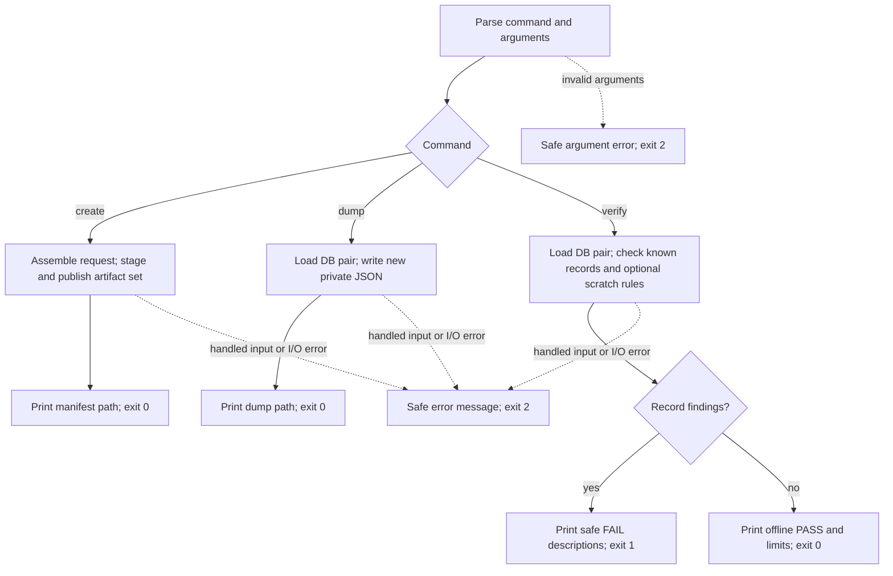
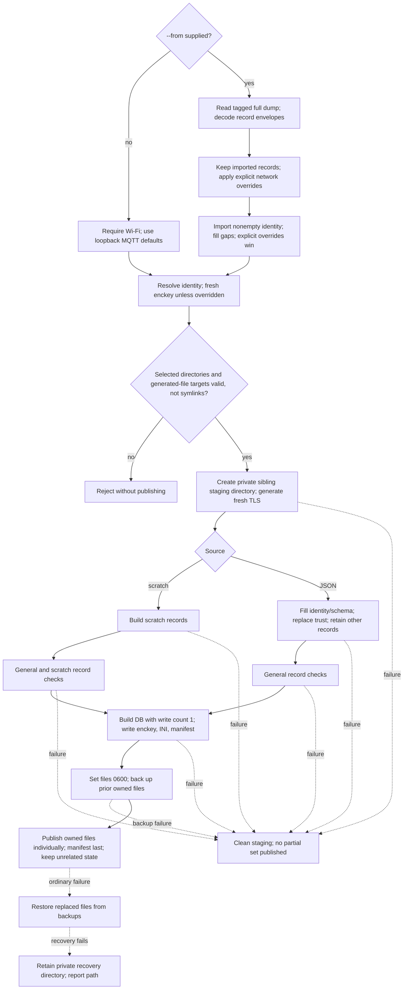
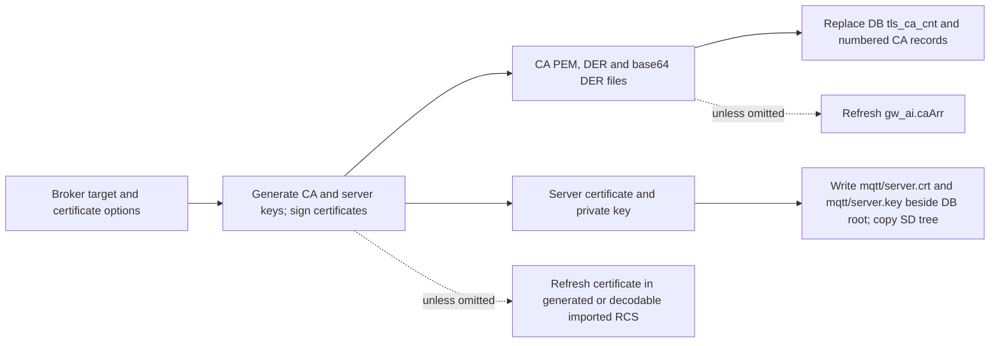
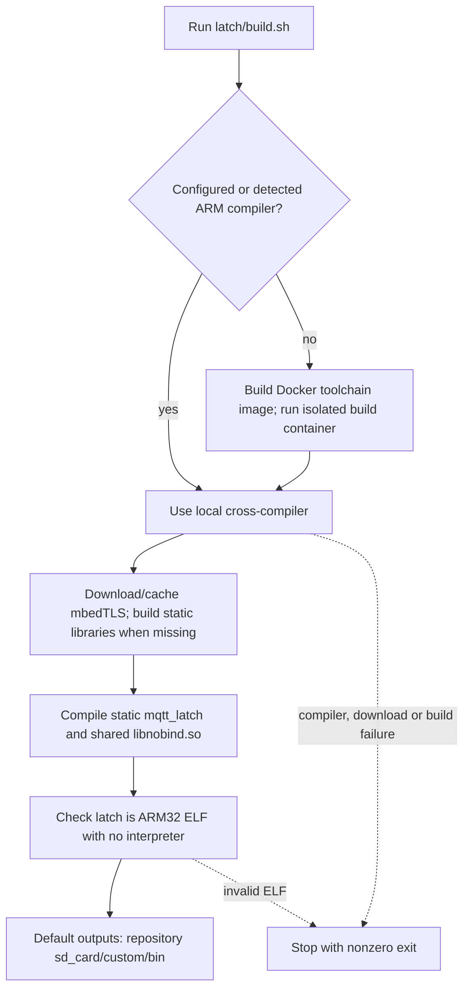

# Creation workflows

These diagrams describe tracked host-side code. For record contents, see [artifact creation](../artifact-flow.md); for commands, see [CLI reference](../cli.md).

## Command dispatch

*Three subcommands share safe error handling; verification findings are distinct from input failures.*

Sources: [main.py](../../src/tuyha/cli/main.py), [args.py](../../src/tuyha/cli/args.py), and [inspection workflows](inspection.md). Help exits through the argument parser. None of these paths contacts a camera.

## Scratch or JSON creation

*JSON input retains deployment state; scratch input builds the documented local-boot record set.*

Sources: [request assembly](../../src/tuyha/cli/create.py), [publication](../../src/tuyha/materializer/workflow.py), [import transformation](../../src/tuyha/materializer/imported.py), and [identity defaults](../../src/tuyha/materializer/identity.py). Default state root is cwd-relative `sd_card/custom/state`; TLS files go in `mqtt/`. Newly created directories use `0700`, existing permissions remain. One writer at a time; publication is not atomic across files or safe against power loss. Parsing and validation can reject input before staging.

## Matched TLS material

*Fresh trust is deliberate creation behavior, not a dependency of database dumping.*

Sources: [TLS generator](../../src/tuyha/tls/generator.py), [scratch records](../../src/tuyha/materializer/records.py), [JSON import](../../src/tuyha/materializer/imported.py), and [deployment](../../README.md#3-prepare-the-sd-card). Both certificates start in 1999 and expire 365 days after creation by CLI default. The CA private key is not emitted. Keep the entire artifact set private.

## Optional latch rebuild

*The container is a cross-build tool, not a camera runtime service.*

Source: [latch/build.sh](../../latch/build.sh). `LATCH_OUTPUT_DIR` and `LATCH_CACHE_DIR` isolate outputs/cache; `LATCH_CC` selects a compiler. A successful cross-build or ELF check does not prove camera operation. Existing binaries are included, so normal setup does not require a rebuild.
