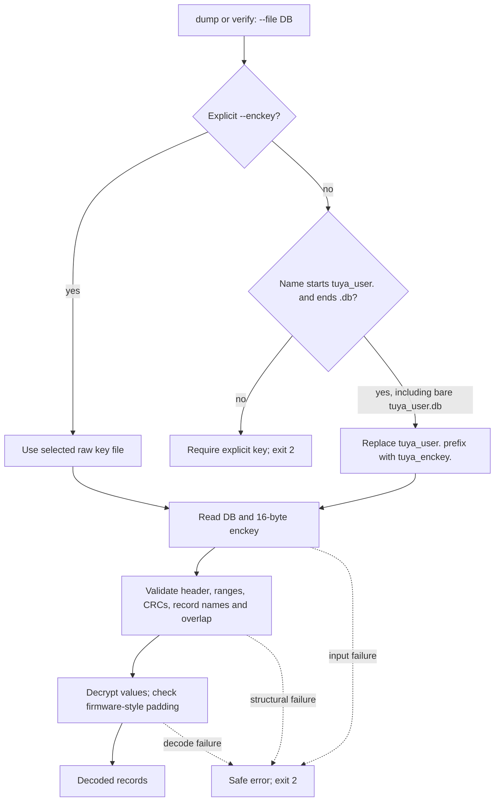
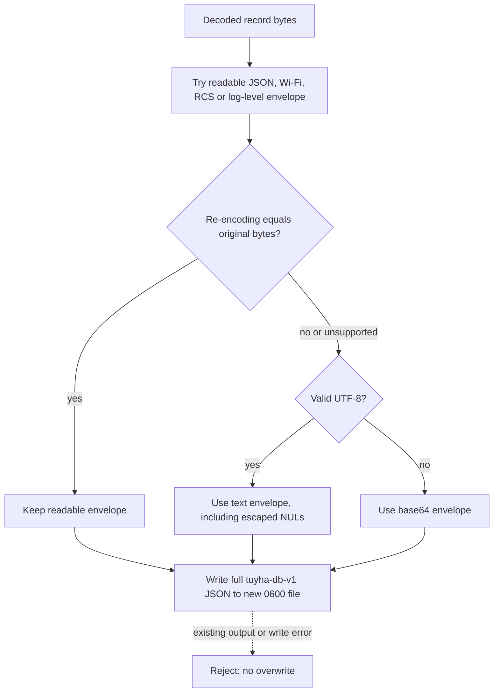
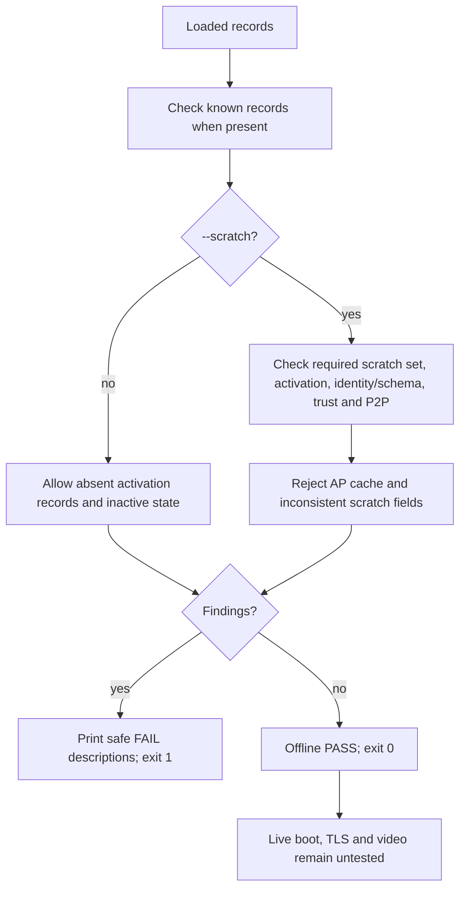

# Dump and verification workflows

These are offline file operations. A successful dump or verification does not prove camera acceptance. See [CLI reference](../cli.md) and [hardware validation](../hardware-validation.md).

## Resolve and load a DB pair

*DB inspection needs the matching raw enckey, never a TLS private key or broker.*

Sources: [inspection adapter](../../src/tuyha/cli/inspect.py), [DB codec](../../src/tuyha/anyka/db.py). CRC32 and weak padding are not authentication.

## Exact dump envelopes

*Readable records never replace byte preservation; the fallback retains arbitrary decoded values.*

Sources: [json_dump.py](../../src/tuyha/anyka/json_dump.py), [exclusive output creation](../../src/tuyha/cli/inspect.py). Dump contents are unredacted. Recreating from this JSON intentionally transforms trust and other listed fields, so it is not a whole-DB clone.

## General versus scratch checks

*General checks inspect known data; scratch checks enforce the generator's additional contract.*

Sources: [general verifier](../../src/tuyha/anyka/verify.py), [scratch verifier](../../src/tuyha/anyka/scratch_verify.py), [CLI result handling](../../src/tuyha/cli/main.py). Unknown record semantics are not validated. Reports contain field names, not values.
