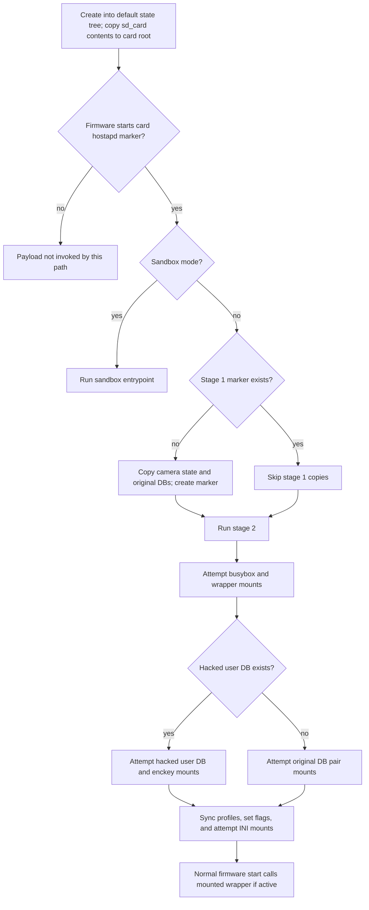
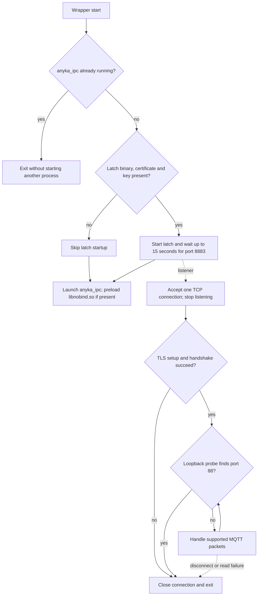
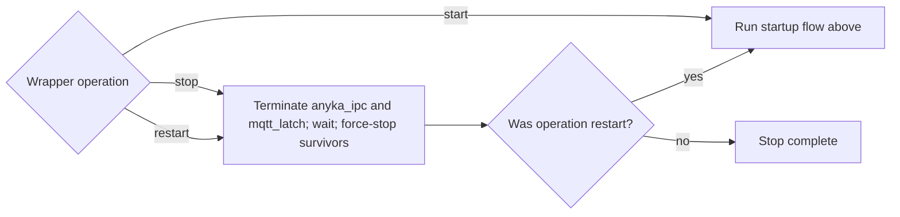

# SD deployment and boot

This flow describes the default SD payload and latch source. It does not prove that a particular card booted or that the binaries match the source. See the [SD payload guide](../SD_CARD.md) and [hardware runbook](../hardware-validation.md).

## Payload and database selection

*Stage 1 captures camera state; stage 2 selects the DB pair by hacked user-DB presence.*

Sources: [hostapd](../../sd_card/hostapd), [stage 1](../../sd_card/custom/scripts/hack_stage_1.sh), [stage 2](../../sd_card/custom/scripts/hack_stage_2.sh), and [mount helper](../../sd_card/custom/env.sh). Copies and mounts can fail without stopping the scripts. The stage 1 marker is not proof that every copy succeeded. Missing hacked DB or a failed mount can leave factory state active and may allow cloud access. Check stage logs and active mounts.

## Latch startup and exit

*The wrapper starts the latch before the camera process; the latch exits after its one connection ends or its port probe succeeds.*

Sources: [startup wrapper](../../sd_card/custom/scripts/anyka_ipc.sh), [latch source](../../latch/mqtt_latch.c), and [preload source](../../latch/nobind.c). The listener binds all interfaces, not only loopback, and does not authenticate clients. An unrelated client can occupy the sole connection. The wrapper's port check alone does not prove that the intended latch owns the port; the port 88 probe alone does not prove decoded video. The source has no RTSP probe while waiting in `accept()` or the TLS handshake.

## Wrapper stop and restart

*Restart executes the wrapper's stop sequence before a fresh start.*

Source: [anyka_ipc.sh](../../sd_card/custom/scripts/anyka_ipc.sh). A restart does not rerun stage 2 or prove that bind mounts changed.
