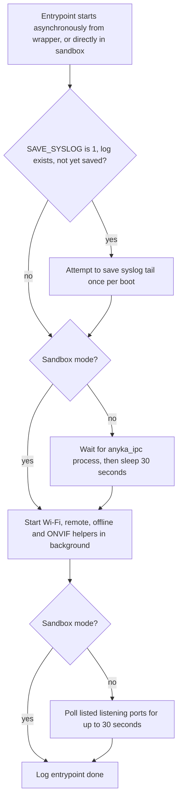
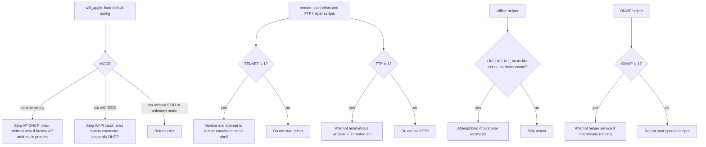

# SD entrypoint and helpers

These diagrams describe the checked-in scripts and configuration, not proof that they ran on a camera. The wrapper starts `entrypoint.sh` in the background after launching `anyka_ipc`. The sandbox path can also run the entrypoint directly. See [SD deployment and boot](sd-boot.md).

## Entrypoint sequencing

*The entrypoint launches helpers concurrently; it does not wait for them to complete before its port check.*

Sources: [entrypoint.sh](../../sd_card/custom/scripts/entrypoint.sh), [wrapper](../../sd_card/custom/scripts/anyka_ipc.sh), and [hostapd](../../sd_card/hostapd). The syslog copy is attempted, not confirmed. The port check includes ports other than RTSP and can match a listener without process identification; it does not establish RTSP or decoded video.

## Helper configuration branches

*Each helper reads configuration independently; the branches can run concurrently.*

Sources: [wifi_apply.sh](../../sd_card/custom/scripts/wifi_apply.sh), [remote.sh](../../sd_card/custom/scripts/remote.sh), [telnet.sh](../../sd_card/custom/scripts/telnet.sh), [ftp.sh](../../sd_card/custom/scripts/ftp.sh), [offline.sh](../../sd_card/custom/scripts/offline.sh), [onvif.sh](../../sd_card/custom/scripts/onvif.sh), and [hack.conf](../../sd_card/custom/configs/hack.conf). With the checked-in `hack.conf`, `TELNET=1` and port `24`, `FTP=0`, `OFFLINE=1`, `ONVIF=0`, and `SAVE_SYSLOG=0`. Telnet, if started, gives an unauthenticated shell; isolate the camera from untrusted networks or disable it. If enabled, the FTP helper attempts to start anonymous writable FTP rooted at `/`. A hosts bind is not proof that all cloud traffic is blocked; check the mount and network policy.

The Wi-Fi helper calls `load_cfg` with no filename, so it reads `hack.conf`, not `wifi.conf`. Its default `MODE=none` applies when `hack.conf` does not override it. The checked-in `wifi.conf` also says `MODE=none`, but changing that file alone does not change this helper's mode. `MODE=sta` is a debug path and may race the firmware join. The optional SD `ONVIF` helper is distinct from the firmware `bool_onvif_switch` set by stage 2. A log message after an attempted mount or service start does not prove success.
