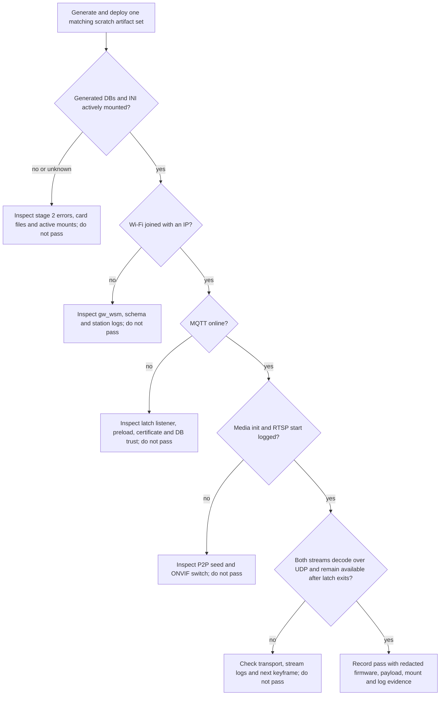

# Hardware validation and troubleshooting

Use this decision path with the [hardware validation runbook](../hardware-validation.md), not as a substitute for its raw evidence. The reported successful scratch result covers one LSC camera; see [evidence scope](../research/index.md#evidence-and-scope).

*Each checkpoint rules out a false positive before declaring this hardware run successful.*

Sources: [runbook](../hardware-validation.md), [troubleshooting](../troubleshooting.md), and [boot-to-RTSP guide](../LOCAL_RTSP.md). Branches identify checks, not guaranteed diagnoses. A listening port, a `Hack Stage 2 done.` line, `WSS_CONNECTING`, or MQTT online alone is not sufficient. Keep raw logs, artifacts, dumps and manifests private; redact before sharing.
