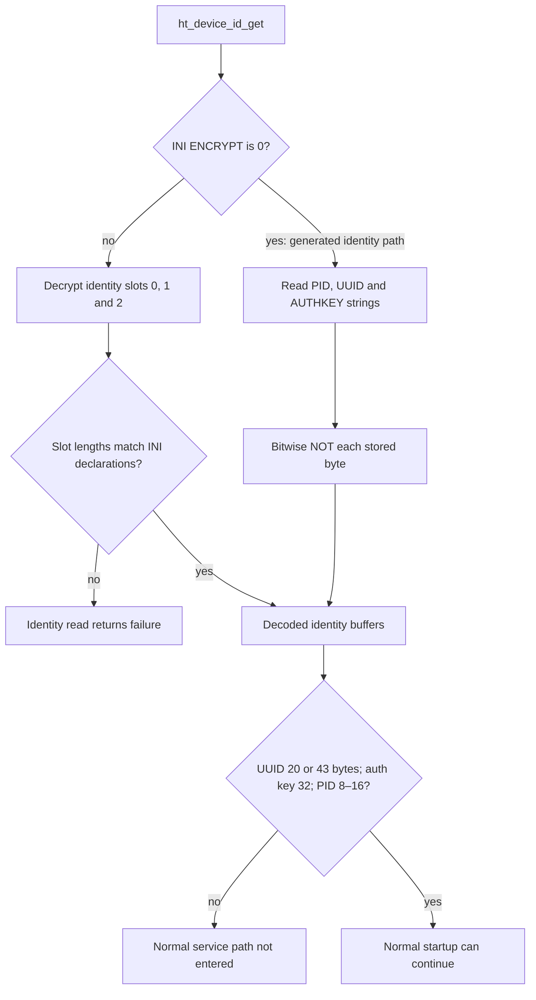
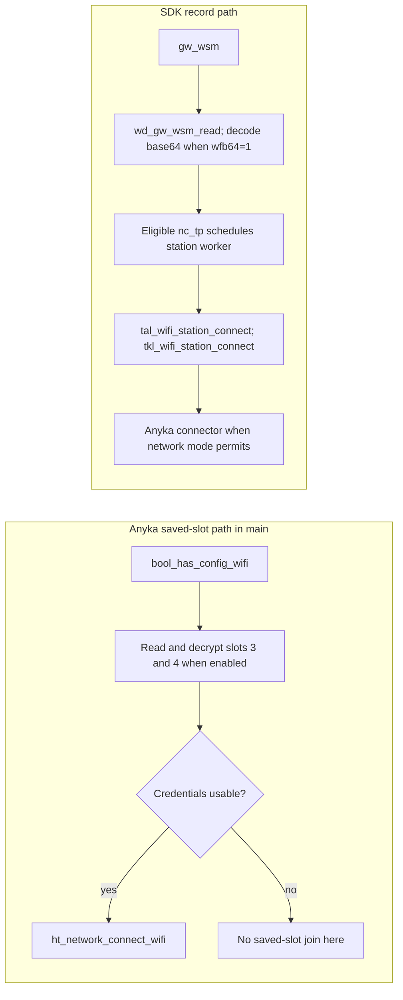

# Boot and Wi-Fi

These findings describe the [examined firmware](index.md#examined-firmware), not every Anyka camera.

See [boot diagrams](diagrams/boot-media.md) for the service gate and [Wi-Fi internals](diagrams/wifi.md) for credential, cache and adapter branches.

## Identity and service gate

**Firmware analysis:** `main()` reads identity, initializes the network, validates identity, and calls `ht_tuya_service_start()`. `ht_device_id_get()` reads `PID`, `UUID` and `AUTHKEY` from the INI when `ENCRYPT=0`, then applies bitwise NOT per byte. The validators called by `ht_tuya_uuid_check()` accept a UUID of 20 or 43 bytes, an auth key of 32 bytes, and a PID of 8–16 bytes. These length checks do not establish cloud or SDK acceptance.

*The generated INI selects byte inversion, not the encrypted-slot branch; validation here checks lengths, not cloud credentials.*

The encrypted branch can also read slot 8 when its caller requests the additional key. [_ht_uuid.ini generation](../../src/tuyha/materializer/uuid_ini.py) supplies the byte-inverted strings used by the current payload.

**Firmware analysis:** Once SDK initialization succeeds, `ht_tuya_service_start()` polls `TUYA_IPC_Get_MqttStatus()`. It logs `wait mqtt online.` while the status is not 1. When it is 1, the function logs `tuya mqtt online.`, calls `TUYA_APP_Media_Init()`, then continues to ONVIF and other services. This describes this service path, not every possible firmware boot mode.

**Implementation:** Stage 2 may fall back to the original DB if the hacked user DB is missing, and an unsuccessful bind mount can leave factory state active. File presence alone is not proof of selection. See [stage 2](../../sd_card/custom/scripts/hack_stage_2.sh) and the [validation runbook](../hardware-validation.md).

## Station join

**Firmware analysis:** `wd_gw_wsm_read()` reads `gw_wsm`. When `wfb64=1`, it base64-decodes SSID and password into the Wi-Fi state. `tuya_wifi_connect_init()` schedules the normal connection worker for several network configuration types, including `nc_tp=9`. The worker reaches `tal_wifi_station_connect()` only when the SSID is nonempty and the fast-connect/already-connected conditions do not suppress it. Its `tkl_wifi_station_connect()` adapter can invoke the Anyka Wi-Fi connector, depending on network mode.

**Firmware analysis:** The `db.init` fast-connect handler reads saved AP information and, on a successful fast-connect call, sets a flag. In this binary, `tkl_wifi_station_fast_connect()` returns 0 without joining. The normal worker skips its connect call when that flag is set. Scratch generation leaves `ap_info_v3` absent to avoid this path.

**Implementation:** [records.py](../../src/tuyha/materializer/records.py) generates `gw_wsm` with `wfb64=1`, `nc_tp=9`, and `stat=2`, and does not generate `ap_info_v3`. The [scratch verifier](../../src/tuyha/anyka/scratch_verify.py) rejects that record for `verify --scratch`; general verification permits inactive/non-scratch state. The SD [Wi-Fi helper](../../sd_card/custom/scripts/wifi_apply.sh) defaults to `MODE=none` and reads [hack.conf](../../sd_card/custom/configs/hack.conf), which does not override it. In that mode the helper leaves station handling to the firmware.

The helper does not read [wifi.conf](../../sd_card/custom/configs/wifi.conf); changing that file alone does not change its mode.

## Two sources of station credentials

*Saved slots and `gw_wsm` feed separate join paths; absence of usable saved slots does not establish that the SDK worker ran.*

See [adapter decisions](diagrams/wifi.md#station-adapter-network-mode) and [status reporting](diagrams/wifi.md#connection-status-reporting) before interpreting connection logs.

## Limits

`WSS_CONNECTING` is not evidence of an IP address or successful station association. Firmware and SD logs can print Wi-Fi credentials or identity values. Redact before sharing. Do not assume cache handling, network-mode behavior, or adapter stubs match another build.
