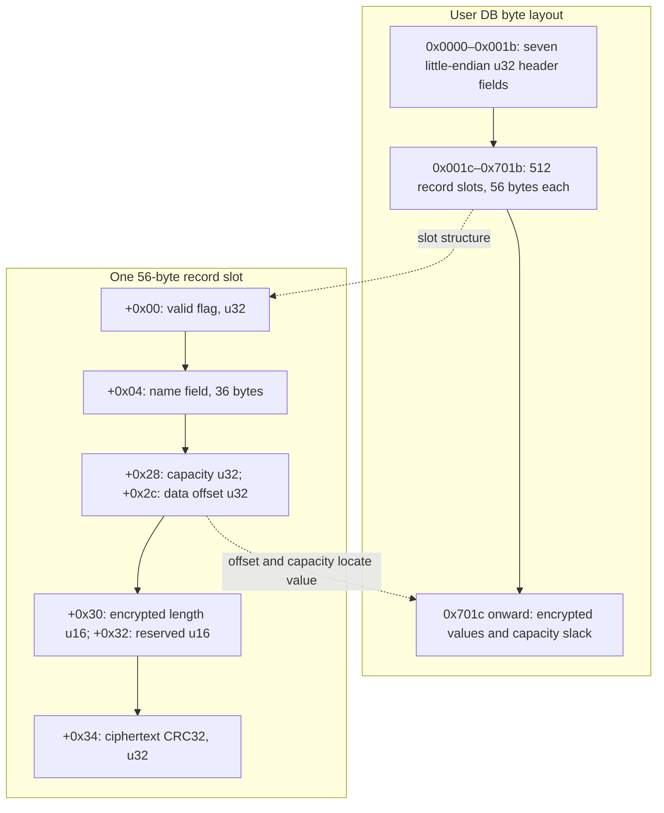
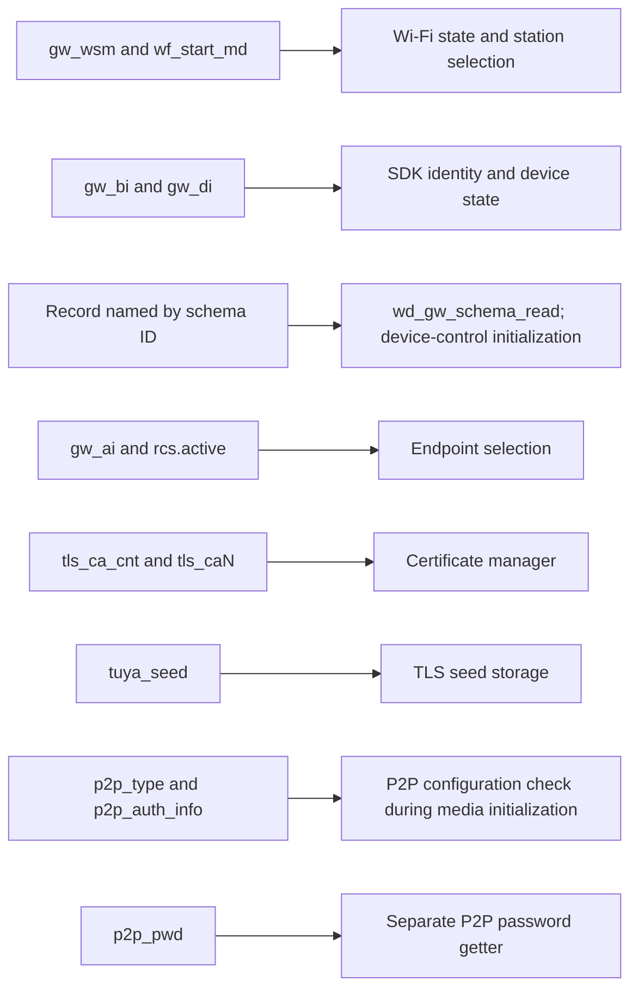

# Database and identity

The following describes the checked-in codec and generated records. It is not a complete specification for all Tuya databases. Firmware findings apply to the [examined executable](index.md#examined-firmware).

See [database and logging diagrams](diagrams/database.md) for build, load and log-level expiry paths.

## KV file format

**Implementation:** [db.py](../../src/tuyha/anyka/db.py) uses a 28-byte little-endian header followed by a fixed table of 512 entries, each 56 bytes. The header includes magic `0x55AA55AA`, version, write count, table size, maximum record count, and record count. The builder writes version `2`, sorts record names, and stores each entry's valid flag, name, capacity, offset, encrypted length, and CRC32. The header CRC32 covers the header after its CRC field and the active record entries; each data CRC32 covers ciphertext.

*The fixed record table ends at `0x701c`; each active slot points to a separately encrypted value.*

The builder limits UTF-8 names to 32 bytes even though the name field occupies 36 bytes. See [key derivation and padding](diagrams/database.md#key-derivation-and-value-encryption) for the value transformation.

**Implementation:** [crypto.py](../../src/tuyha/anyka/crypto.py) derives an AES key from the 16-byte enckey by rotating four little-endian 32-bit words from `0,1,2,3` to `2,3,0,1`, then swapping adjacent bytes. Each value is padded with PKCS#7 and encrypted with AES-128-ECB. The decoder's padding check is deliberately weak; a successful decode does not prove authenticity. CRC32 is not a cryptographic integrity check. [Codec tests](../../tests/unit/test_db_codec.py) exercise a synthetic round-trip, not camera acceptance.

## Record families

**Implementation:** [records.py](../../src/tuyha/materializer/records.py) builds these records for scratch generation. This is the generated set, not a claim that every member is necessary on all firmware.

| Record | Purpose or encoding in generated set |
|---|---|
| `gw_wsm` | Wi-Fi settings and activation state; SSID and password are base64-encoded, not concealed. |
| `gw_ai` | LAN keys, MQTT and HTTP endpoint fields; optional `caArr`. |
| `gw_bi`, `gw_di` | Identity and authentication fields. |
| Schema ID as key | JSON bytes `[]`. The key name itself may identify the deployment. |
| `rcs.active` | Register-center tuple encoded as TLV. |
| `tls_ca_cnt`, `tls_ca0` | NUL-terminated count and base64 DER CA certificate. |
| `tuya_seed` | Generated TLS seed bytes. |
| `wf_start_md` | Station-mode value `2`, followed by NUL. |
| `p2p_type`, `p2p_auth_info`, `p2p_pwd` | Values intended to avoid a P2P configuration fetch on the examined path. See [media and RTSP](media-rtsp.md). |

**Firmware analysis:** Device-control initialization calls `wd_gw_schema_read()` when the schema ID is nonempty. The [generator](../../src/tuyha/materializer/records.py) supplies a schema record to prevent Wi-Fi state reset on the examined path. This is not a general requirement for every camera.

*Record families affect different consumers; a well-formed DB does not prove that each consumer accepted its values.*

These are consumer relationships, not a complete execution order. The [media](media-rtsp.md) and [trust](mqtt-tls-rcs.md#trust-records) pages explain the branches used by the local path.

## Logging state

**Implementation:** The [tagged JSON codec](../../src/tuyha/anyka/json_dump.py) represents an eight-byte `localLogLevel` as a `log-level` envelope with `level` and `expires_at`: two little-endian unsigned 32-bit values. Levels `0`–`5` are accepted. Expiry is explicit; there is no integer shorthand or seven-day default. If readable re-encoding would change bytes, dumping falls back to text/base64. Scratch generation does not add this record. The [general verifier](../../src/tuyha/anyka/verify.py) checks its size and level, not whether logging is enabled on a camera.

**Firmware analysis:** The `db.init` handler reads the record and sets the log manager. A `time.sync` handler schedules expiry or deletes the record and restores the prior level if it has expired. Other logging gates may still apply. Treat logs as sensitive: increasing verbosity can expose credentials and identifiers.

## Identity outside the DB

**Implementation:** [_ht_uuid.ini encoding](../../src/tuyha/materializer/uuid_ini.py) writes `pid`, `uuid`, and `authkey` with `encrypt = 0`, applying per-byte bitwise NOT and writing bytes through Latin-1. This matches the examined INI read branch described in [boot and Wi-Fi](boot-wifi.md). The file contains recoverable identity data. Keep it private with the matching DB and enckey.

**Limits:** `ap_info_v3` is absent from scratch output but can survive JSON import. `create --from` preserves imported deployment state while refreshing trust. See [artifact creation](../artifact-flow.md). A local DB reload or shape check does not prove that the camera mounted or accepted the result.
