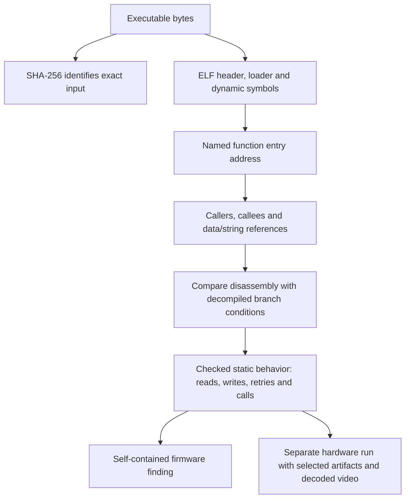
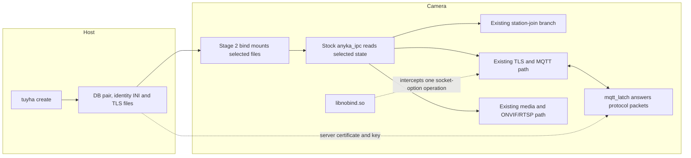
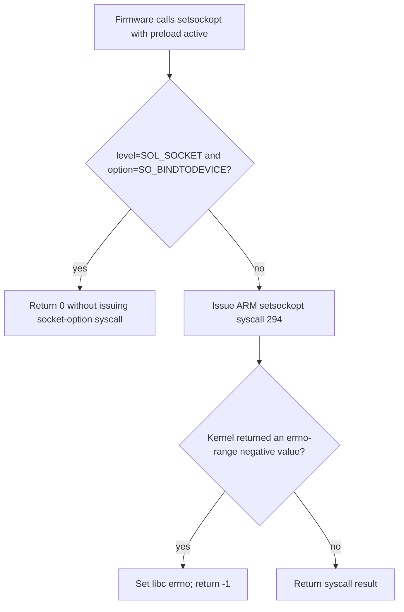

# Decompilation methods and interventions

This page describes the examined executable, the analysis methods and the firmware branches used by the current payload. It is not a firmware-patching procedure.

## Image provenance

The analyzed executable and `/usr/bin/anyka_ipc` extracted from the examined camera filesystem have the same SHA-256:

```text
1b6e8150e4710c1d0b324e4ccb5ba1d93c4ea804742d26b38328aa94d34a88f7
```

`file` and `readelf` identify ELF32 little-endian ARM, EABI5 soft-float, entry point `0x000843a0`, dynamically linked through `/lib/ld-uClibc.so.0`. The file is stripped but retains many dynamic function symbols.

These properties identify the [examined firmware](index.md#examined-firmware). They do not tie it to the reported successful scratch run.

## Evidence workflow

The analysis combined ELF symbols with Ghidra disassembly and per-function decompilation:



*Static analysis establishes what the examined code does on a branch; runtime evidence establishes whether a deployment took it.*

| Method | Result and limit |
|---|---|
| ELF inspection | Identify architecture, loader, entry point and exported function addresses. |
| Call and reference inspection | Follow callers and callees from exported entry points. A reference does not prove runtime execution. |
| String references | Locate DB record names and log messages, then inspect the conditions around their use. |
| Per-function decompilation | Check reads, comparisons, retries and calls against the disassembly. |
| Callback-state tracing | Separate event-handler state from the public MQTT boot-gate state. See [MQTT status](mqtt-tls-rcs.md#mqtt-events-and-status). |

To inspect another build:

1. Hash the executable and inspect its ELF header and dynamic symbols.
2. Import a copy into Ghidra and use the detected ARM architecture and loader information.
3. Locate the functions below through symbols, then inspect callers, strings and branch conditions.
4. Compare DB reads and return paths with the corresponding [boot](boot-wifi.md), [MQTT](mqtt-tls-rcs.md) and [media](media-rtsp.md) findings.
5. Validate runtime behavior separately with the [hardware runbook](../hardware-validation.md).

## Verified function addresses

Dynamic symbols in the hash-matched ELF establish these entry addresses:

| Function | Address |
|---|---|
| `ht_device_id_get` | `0x000aa2d0` |
| `ht_tuya_service_start` | `0x000cd828` |
| `TUYA_IPC_Get_MqttStatus` | `0x000f05d0` |
| `tuya_ipc_set_mqtt_status` | `0x001e07f0` |
| `ty_publish_event` | `0x001e2824` |
| `ty_subscribe_event` | `0x001e291c` |
| `ty_unsubscribe_event` | `0x001e2ac0` |
| `tkl_wifi_station_connect` | `0x000da914` |
| `tkl_wifi_station_fast_connect` | `0x000da3e0` |
| `TUYA_APP_Media_Init` | `0x000e1128` |
| `TUYA_IPC_Media_Stream_Init` | `0x000edc28` |
| `tuya_imm_p2p_init` | `0x00247ddc` |
| `tuya_ipc_check_p2p_auth_update` | `0x00248678` |
| `tuya_ipc_p2p_get_pw` | `0x0024819c` |
| `IPC_APP_set_onvif_onoff` | `0x000eac00` |
| `ht_rtsp_start` | `0x000bda44` |

Check with `readelf --dyn-syms --wide PATH_TO_BINARY` on the matching image. Addresses apply only to that executable. Use the entry address, function body and call site together when tracing behavior.

## What the current payload changes



*The payload supplies files and a narrow socket-option interception; it does not replace the firmware service or call its functions from the host.*

| Intervention | Existing behavior used or avoided | Evidence and limit |
|---|---|---|
| Mount DB pair and identity INI | Makes stock firmware read generated state instead of factory state. | [Stage 2](../../sd_card/custom/scripts/hack_stage_2.sh); failed mounts/fallback can leave factory state active. |
| `nc_tp=9`, `stat=2`, no AP cache in scratch | Selects the station worker; avoids the examined success-returning fast-connect stub suppressing the real join. | [Wi-Fi research](boot-wifi.md#station-join); build-specific inference. |
| Local TLS endpoint and MQTT latch | Passes the initial connection/status gate through the existing SDK path. | [MQTT research](mqtt-tls-rcs.md); this does not force a getter's return value. |
| `libnobind.so` | Intercepts `setsockopt`; suppresses only `SOL_SOCKET` / `SO_BINDTODEVICE`. Other calls use the ARM syscall and preserve errno. | [nobind.c](../../latch/nobind.c); runtime preload, not an on-disk firmware patch. |
| Canonical `p2p_type=4` and auth JSON | Avoids the examined HTTP P2P configuration retry before media can continue. | [Media research](media-rtsp.md#p2p-configuration-gate). No real P2P claim. |
| Nonempty `p2p_pwd` | Avoids a separate password fetch. | Separate getter/callback path, not established as part of the media-init call chain. |
| Software INI flags | Bypasses Anyka bind UI and enables the normal ONVIF/RTSP path after media initialization. | [SD guide](../SD_CARD.md); not the separate factory test branch. |

The examined `main()` separates normal service startup from factory-test/direct-RTSP branches and an optional old-test path. The current payload uses normal service startup. After the initial MQTT gate, `ht_tuya_service_start()` enters a monitoring loop rather than repeating that initial wait. A live run must establish sustained video after latch exit.

The host CLI never calls these firmware functions directly. It creates files consumed by the existing program. Keep decompile interpretation separate from [tracked implementation and reported hardware](index.md#evidence-and-scope).

## Socket-option interception



*The tracked preload suppresses device binding only; other socket options retain syscall and errno behavior.*

Source: [nobind.c](../../latch/nobind.c). This does not force MQTT online, disable TLS checks or prove the preload loaded on a camera.
