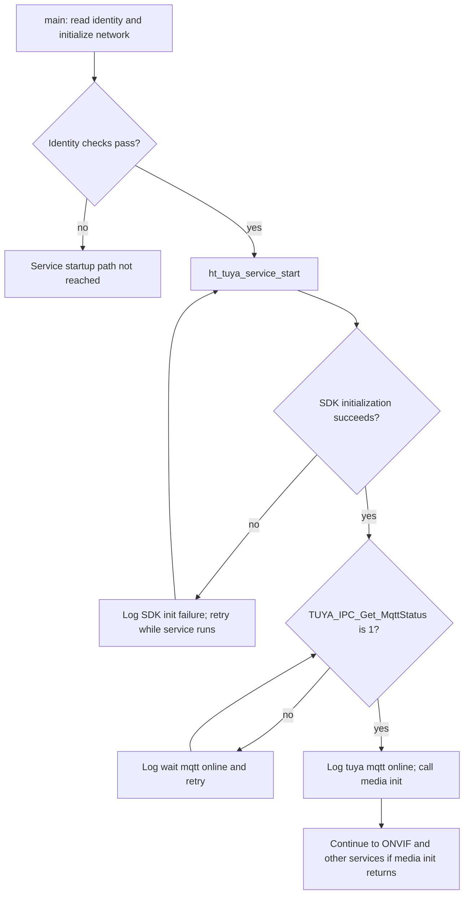
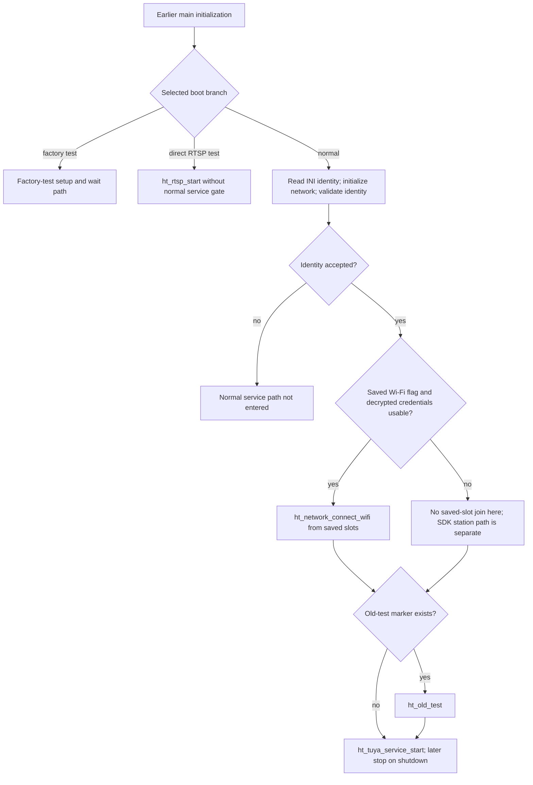
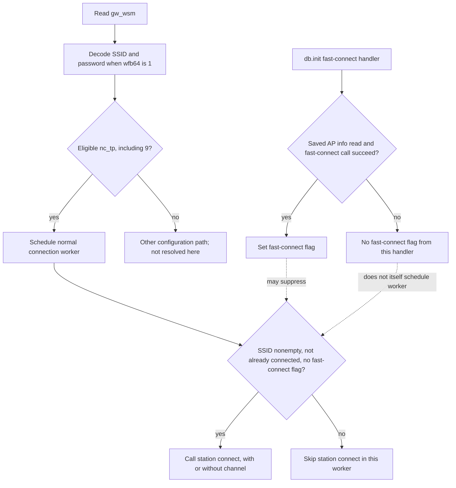
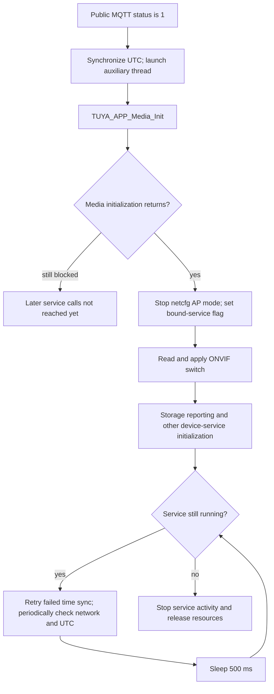
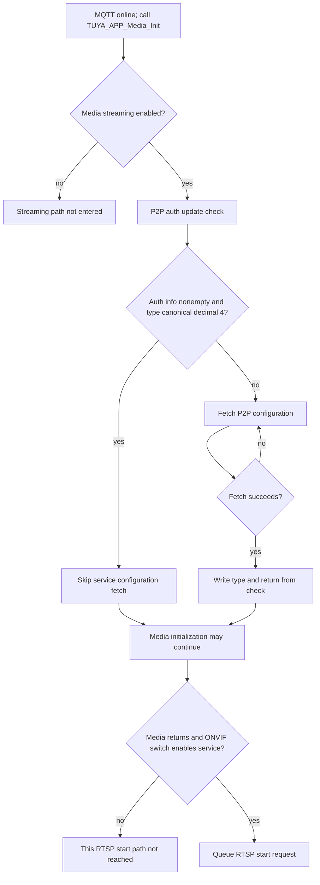
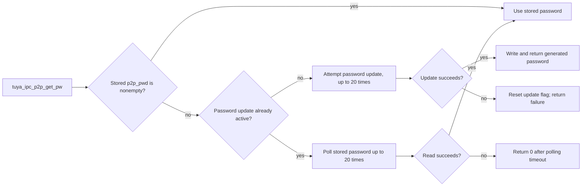

# Firmware boot, Wi-Fi and media

These diagrams describe the [examined firmware](../index.md#examined-firmware), not every camera. Static branch analysis is separate from the [reported single-camera result](../index.md#evidence-and-scope).

## Service boot gate

*The examined service path waits on the public MQTT status before media initialization.*

Functions: `main()`, `ht_device_id_get()`, `ht_tuya_uuid_check()`, `ht_tuya_service_start()` and `TUYA_IPC_Get_MqttStatus()`. See [boot research](../boot-wifi.md#identity-and-service-gate) for identity encoding and length checks. Wi-Fi setup and the SDK may run asynchronously; this graph does not specify their complete timing.

## Normal versus factory branches

*The current payload uses normal startup, not the separate factory or direct-RTSP test branches.*

Function: `main()`; see [decompilation methods](../decompilation.md). The saved-Wi-Fi path decrypts credential slots 3 and 4 before calling `ht_network_connect_wifi()`. It is separate from the SDK station worker. This diagram does not reproduce every initialization or shutdown action.

## Wi-Fi station and fast-connect paths

*The normal worker and fast-connect handler are separate paths; their timing is not established by this diagram.*

Functions: `wd_gw_wsm_read()`, `tuya_wifi_connect_init()` and `tkl_wifi_station_fast_connect()`; see [station-join findings](../boot-wifi.md#station-join). The examined fast-connect adapter returns success without joining, and the normal worker skips its call when the flag is set. Scratch generation omits `ap_info_v3`; see [records.py](../../../src/tuyha/materializer/records.py).

For separate credential, cache, network-mode and status diagrams, see [Wi-Fi internals](wifi.md).

## Service after the initial MQTT gate

*The post-initialization monitoring loop does not repeat the initial MQTT-status gate while it remains active.*

Function: `ht_tuya_service_start()`. Its online/offline monitoring messages use `ht_network_get_connect_state()`, not a new read of the public MQTT getter. This does not prove sustained video after disconnect; [runtime validation](../../hardware-validation.md) must check that separately.

## P2P configuration and RTSP

*The checked P2P configuration branch can delay media initialization before the RTSP start path.*

Functions: `TUYA_APP_Media_Init()`, `TUYA_IPC_Media_Stream_Init()`, `tuya_ipc_media_stream_init()`, `tuya_imm_p2p_init()` and `tuya_ipc_check_p2p_auth_update()`; see [media research](../media-rtsp.md). The separate password getter is not placed in this call chain. A listener is not proof of video decode or real P2P.

The RTSP start call queues work; see [RTSP runtime](media-runtime.md) for the worker, listener/session failures and frame delivery.

## Separate P2P password path

*The password getter has its own fallback and retry path.*

Function: `tuya_ipc_p2p_get_pw()`; see [media research](../media-rtsp.md#p2p-configuration-gate). A polling timeout returns 0 without establishing that a password was obtained. This getter does not establish real P2P capability.
