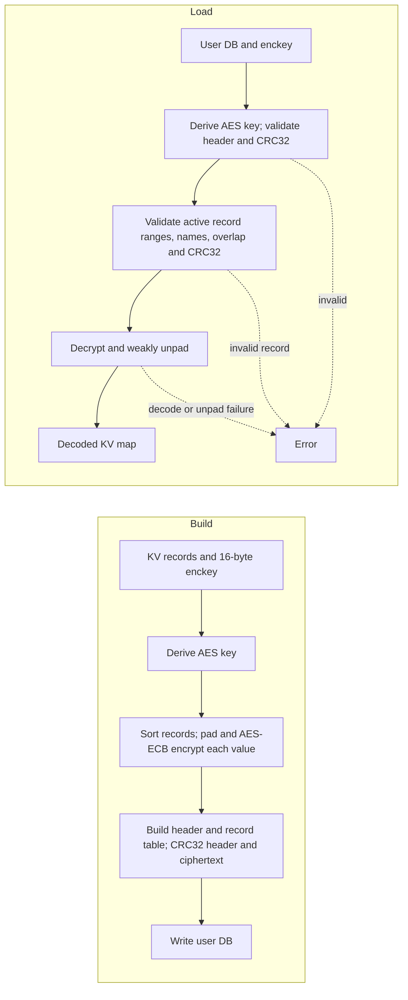
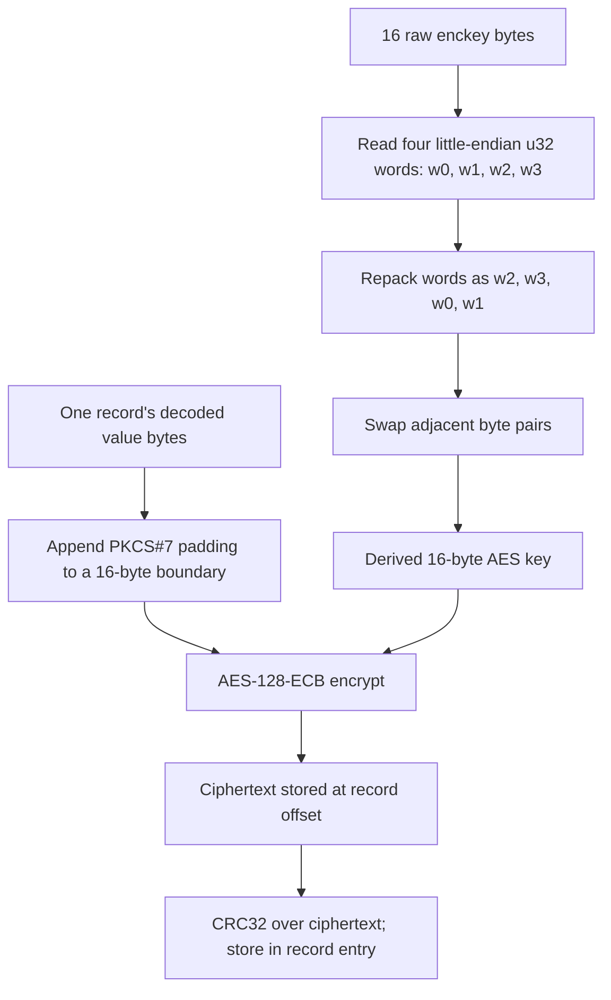
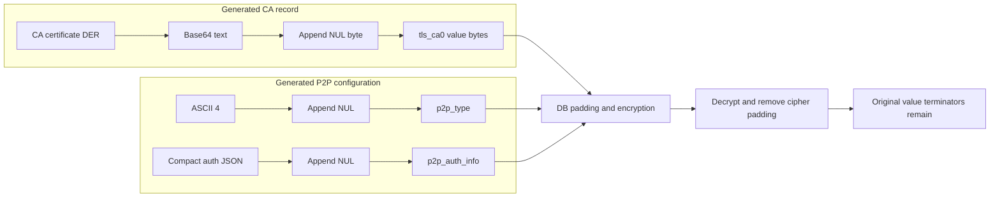
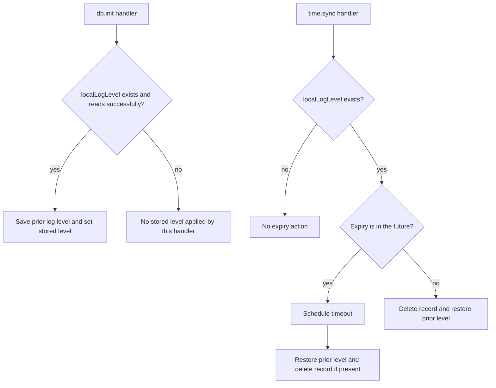

# Database and logging state

The codec diagram describes tracked implementation, not all Tuya formats. The logging diagram describes the [examined firmware](../index.md#examined-firmware).

## DB build and load

*The tracked builder encrypts record values; the reader checks CRCs before decoding.*

Sources: [db.py](../../../src/tuyha/anyka/db.py), [crypto.py](../../../src/tuyha/anyka/crypto.py), and [database research](../database.md#kv-file-format). CRC32 and the weak padding check do not authenticate the DB. A successful reload is not proof that firmware will accept it.

## Key derivation and value encryption

*Each record is encrypted separately with the derived key; CRC32 covers its ciphertext, not a cryptographic authentication tag.*

Source: [crypto.py](../../../src/tuyha/anyka/crypto.py). Even a value already aligned to 16 bytes receives a full padding block. The reader uses a weaker length check than strict PKCS#7 validation, so a decoded result is not authenticity evidence.

## Value terminators are part of the record

*A record's terminating NUL is payload data; it is separate from AES padding and must survive decoding.*

Source: [records.py](../../../src/tuyha/materializer/records.py). Firmware certificate loading uses string lengths on CA text. The [tagged dump codec](../../../src/tuyha/anyka/json_dump.py) preserves decoded value bytes rather than normalizing terminators away.

## Log-level expiry

*The examined handlers apply a saved log level and use synchronized time to manage its expiry.*

See [logging research](../database.md#logging-state) for the `db.init` and `time.sync` handlers. These handlers do not prove that every logging gate is open. Logs can expose secrets and identifiers.
