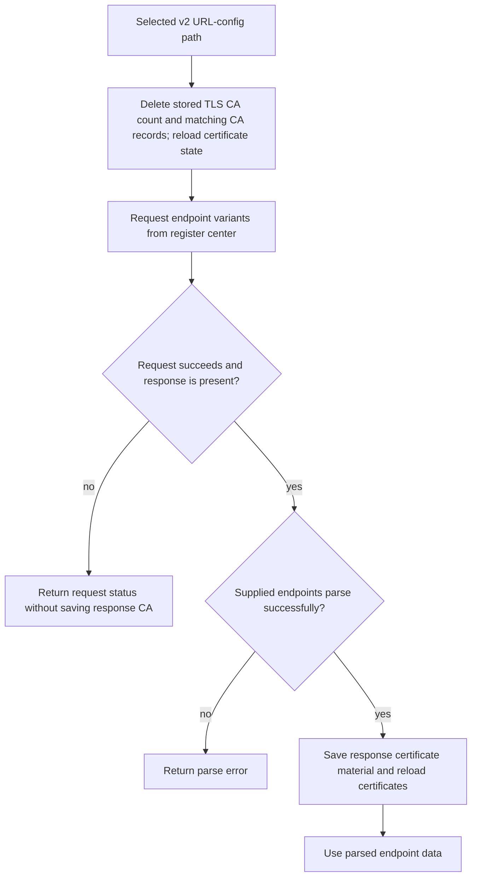
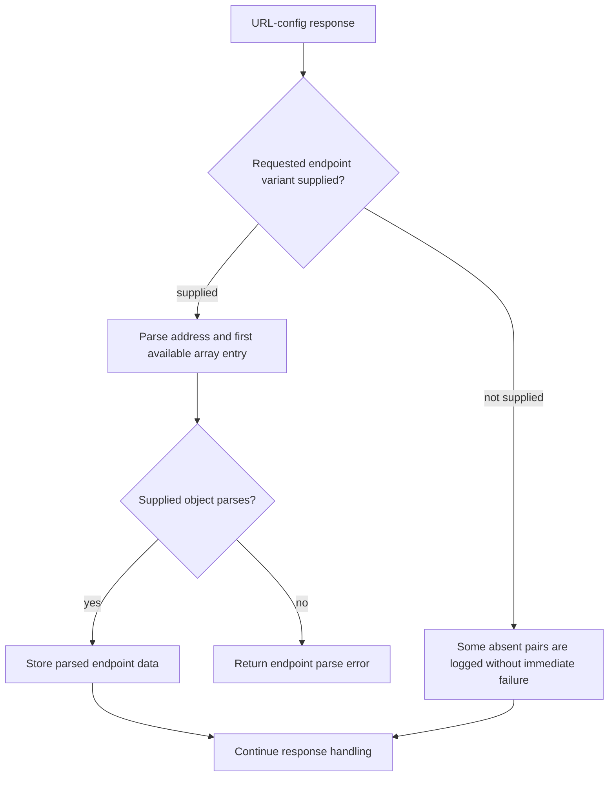
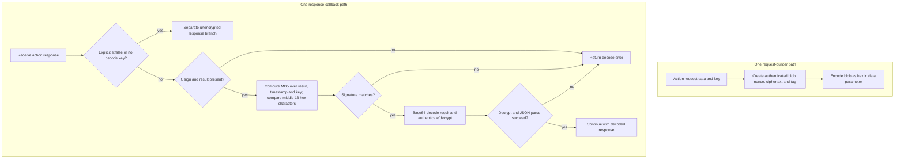
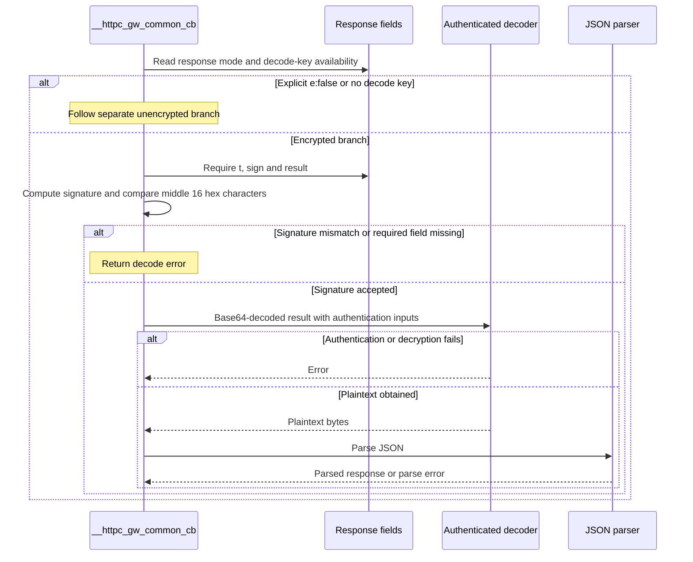

# Firmware HTTP paths

These diagrams describe the [examined firmware](../index.md#examined-firmware), not a supported HTTP service. See [HTTP research](../http-protocol.md) for the checked request and response behavior.

## URL configuration

*The examined v2 path clears CA state before its request and reloads certificates after successful parsing.*

See [URL-config research](../http-protocol.md#url-configuration). A missing response can return the request's status even if it is zero. Some missing endpoint pairs are logged without immediate failure. Failed requests can leave trust state changed; this is not deployment guidance.

## Endpoint-object parsing

*An absent variant and a malformed supplied object do not necessarily take the same branch.*

See [URL-configuration findings](../http-protocol.md#url-configuration). The checked request asks for HTTP, MQTT, standard TLS, PSK and ghost variants. This diagram describes the parser's data dependencies without assigning unverified response-key names.

## Encrypted action exchange

*The request builder and response callback are distinct paths; the encrypted response branch verifies its signature before decryption.*

Function: `__httpc_gw_common_cb()` for the response; see [encrypted exchange research](../http-protocol.md#encrypted-action-exchange). The request builder constructs a separate hex-encoded authenticated blob. This records firmware behavior, not a recommended protocol or proof of app control. Do not publish captures, keys or signing inputs.

## Response decoding gates

*Signature, authenticated decryption and JSON parsing are separate gates; an accepted signature alone does not establish a usable response.*

Function: `__httpc_gw_common_cb()`. No keys, captures or signing-input values are needed to understand these branches.
