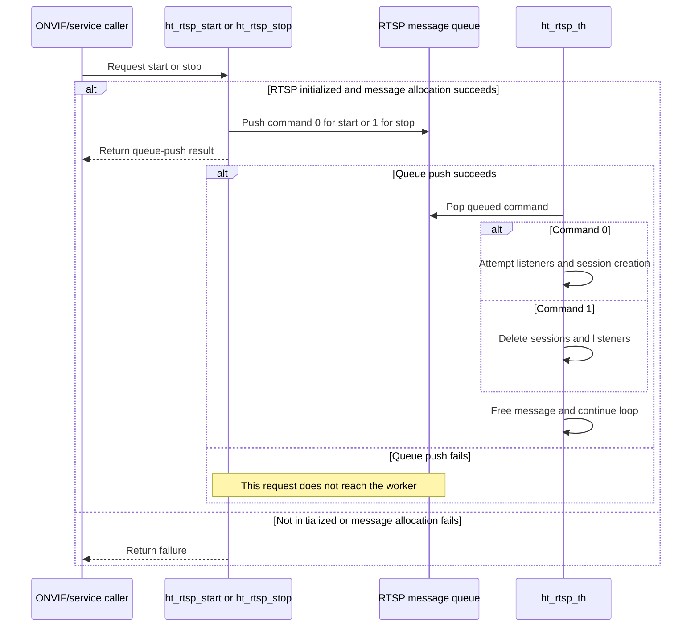
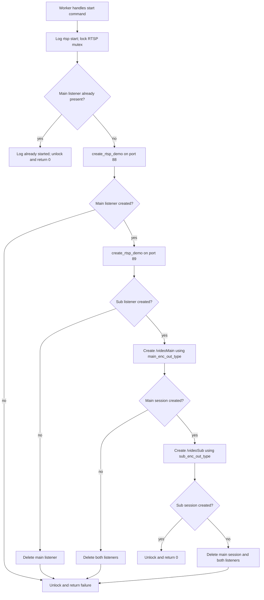
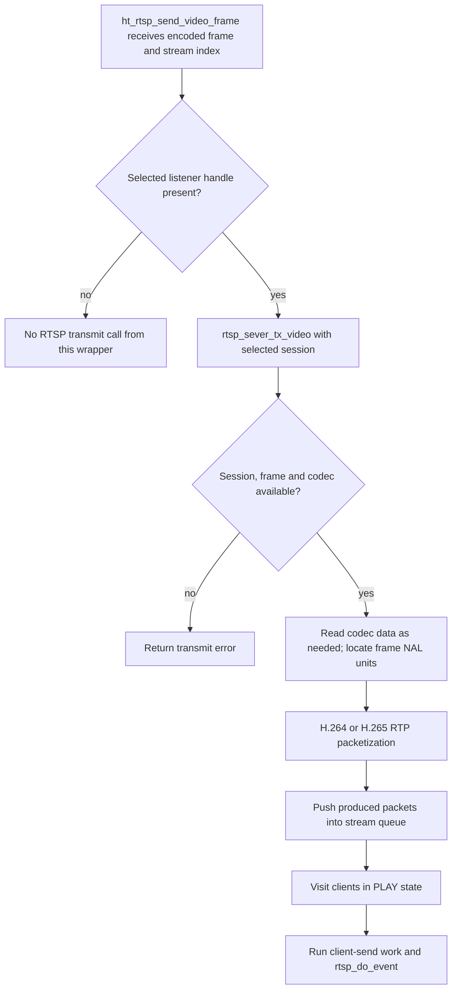
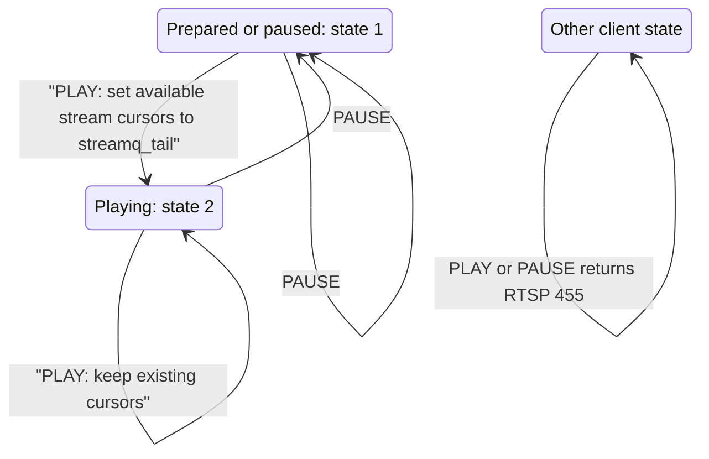

# RTSP runtime

These diagrams describe the [examined firmware](../index.md#examined-firmware). They expand the [media-gate diagrams](boot-media.md#p2p-configuration-and-rtsp), separating start requests from listeners, sessions and video delivery.

## Queued start and stop

*The public request returns the queue operation's result, not the later worker's listener-creation result.*

Functions: `ht_rtsp_init()`, `ht_rtsp_start()`, `ht_rtsp_stop()` and the worker logging `enter ht_rtsp_th`. Initialization creates the queue, mutex and thread; thread creation failure cleans up the queue/mutex. No camera run is implied by this static call relationship.

## Listener and session creation

*The `rtsp start.` log precedes allocation and session creation; it is not proof that both streams are ready.*

The worker's start routine calls `create_rtsp_demo()` and `create_rtsp_session()`. Each session uses codec selector 2 when its `*_enc_out_type` is 2, otherwise selector 1. The transmit path handles selectors 1 and 2 as H.264 and H.265 respectively. A port-88-only probe does not test the sub listener or either codec.

## Video-frame delivery

*A listener handle is only the first condition; frame parsing, RTP packetization and a playing client are separate parts of delivery.*

Functions: `ht_rtsp_send_video_frame()`, `rtsp_sever_tx_video()`, `rtp_enc_h264()`, `rtp_enc_h265()` and `rtsp_do_event()`. Packetization can return an error. This diagram does not claim a complete sensor/encoder pipeline or successful client decode.

## PLAY and PAUSE state

*Entering PLAY selects the current queue tail; repeating PLAY while already playing does not reset those cursors in the checked handler.*

Routines logging `rtsp_handle_PLAY` and `rtsp_handle_PAUSE` accept states 1 and 2; other states receive response `455`. Queue-tail selection does not request a new IDR in this handler. The [reported playback behavior](../media-rtsp.md#playback-observations-and-limits) includes waiting for an IDR and UDP transport; validate decode and duration separately.
