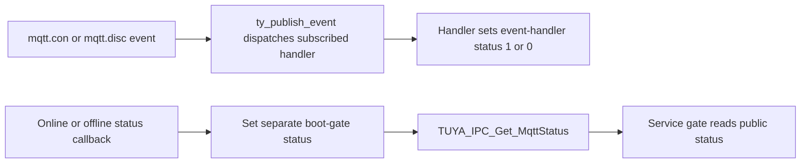
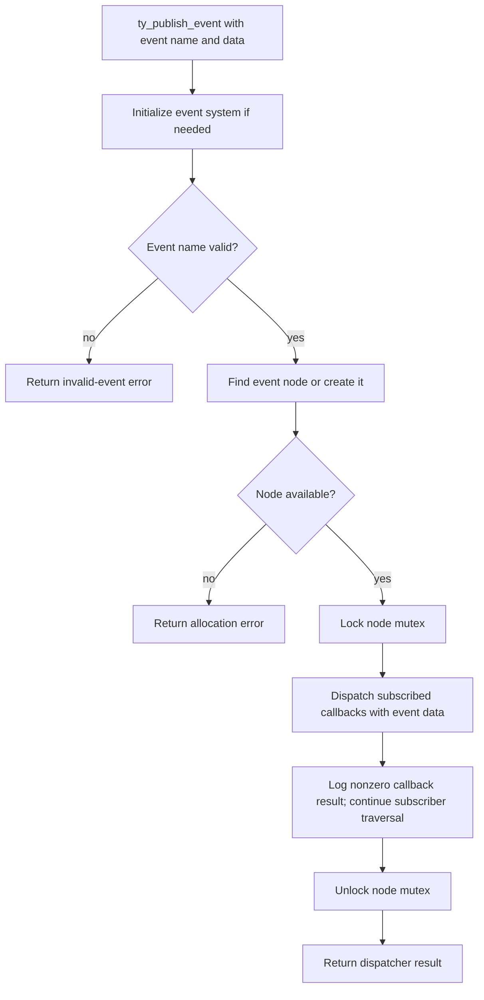
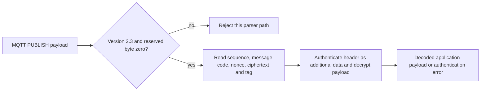
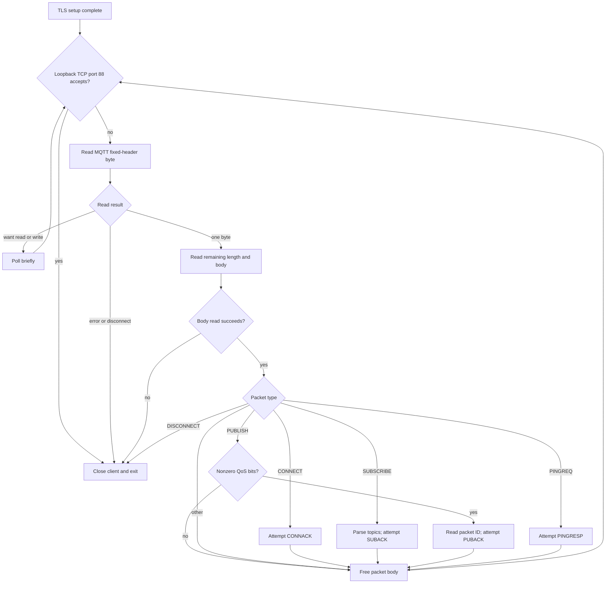
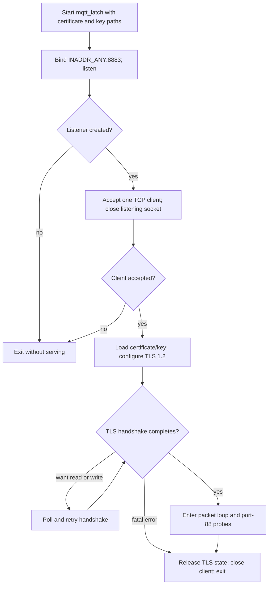
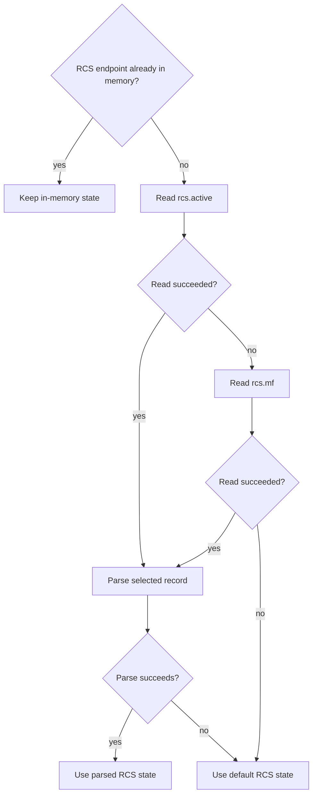
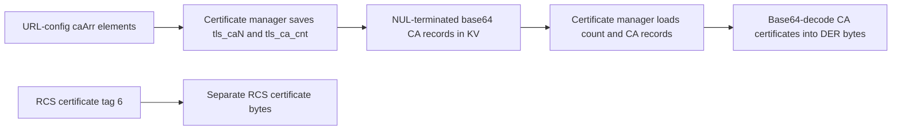
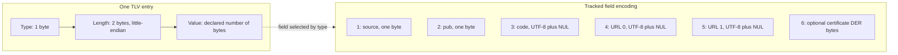
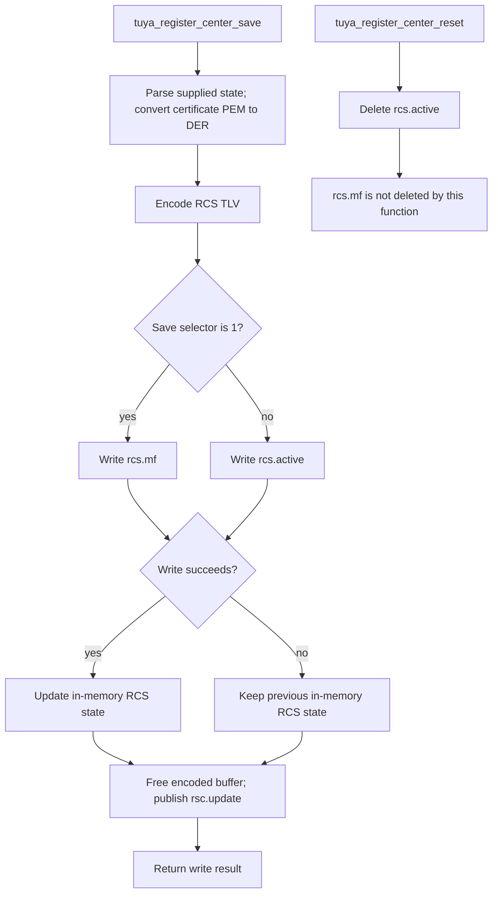

# MQTT status, payload and register center

These diagrams describe the [examined firmware](../index.md#examined-firmware). The tracked [latch flow](../../diagrams/sd-boot.md#latch-startup-and-exit) is separate from the application-payload parser.

## MQTT event and boot-gate status

*Event-handler status and the public boot-gate status are distinct variables.*

Functions: `ty_publish_event()`, `tuya_ipc_set_mqtt_status()` and `TUYA_IPC_Get_MqttStatus()`; see [MQTT status research](../mqtt-tls-rcs.md#mqtt-events-and-status). The two checked paths are shown separately; no call between them is asserted.

## Event dispatch internals

*Callbacks execute within the event node's mutex; publishing dispatches handlers directly rather than proving a later network outcome.*

Functions: `ty_publish_event()` and `_event_node_dispatch()`. The dispatcher also removes subscriptions marked for removal by its checked branch. MQTT connected/disconnected handlers affect their own status variable, as shown above.

## MQTT application payload

*The 2.3 envelope is inside PUBLISH and is separate from the examined MQTT 3.1 CONNECT version.*

See [MQTT payload research](../mqtt-tls-rcs.md#mqtt-23-payload) for byte layout and authenticated header. The latch does not decode this envelope. This is not proof of app control.

## Latch packet dispatch

*The tracked latch checks port `88` between reads, responds by packet type and exits on several non-RTSP paths.*

Source: [mqtt_latch.c](../../../latch/mqtt_latch.c), `serve()`, `read_packet()`, `suback()` and `puback()`. Malformed SUBSCRIBE/PUBLISH bodies can receive no acknowledgement. Reply-write results are not used to prove successful delivery. The QoS-bit condition is source behavior, not a claim of full QoS 2 support.

## Latch connection and TLS lifecycle

*The only accept happens before TLS setup; the latch has no second-client recovery path.*

Source: [mqtt_latch.c](../../../latch/mqtt_latch.c), `main()` and `tls_setup()`. TLS uses the configured server certificate and disables client-certificate verification. A TLS setup error also exits. Isolate the camera network; the all-interface listener must not be treated as authenticated loopback-only access.

## RCS fallback and trust

*The fallback tries `rcs.mf` after a read failure, not after a parse failure.*

Functions: `tuya_register_center_init()` and `tuya_register_center_reset()`; see [RCS research](../mqtt-tls-rcs.md#register-center-fallback). Reset deletes `rcs.active`, not `rcs.mf`; regional default endpoints may be generated. Certificate-manager paths store and load `tls_caN` and `tls_ca_cnt`; RCS tag 6 is another trust surface. Do not assume all surfaces are interchangeable.

## Certificate-manager trust records

*Certificate-manager CA records and the RCS certificate field are distinct trust surfaces.*

See [trust research](../mqtt-tls-rcs.md#trust-records) for the certificate-manager load/save behavior. The [tracked generator](../../../src/tuyha/materializer/records.py) writes its own CA and optional certificate fields; hardware requirements vary by path and firmware.

## RCS TLV representation

*Lengths describe the encoded field bytes, including text terminators; the certificate field contains DER bytes, not base64 text.*

Source: [rcs.py](../../../src/tuyha/anyka/rcs.py). Its fixed eight-byte prefix, `01 01 00 00 02 01 00 01`, contains two TLVs: tag 1, length 1, value 0; tag 2, length 1, value 1. The tracked encoder then emits tags 1 and 2 again with the supplied `source` and `pub`, followed by the remaining fields. Its decoder checks and skips the first eight bytes before parsing those fields.

The firmware parser reads from byte 0; later tags 1 and 2 replace the earlier values. The firmware writer emits `source` and `pub` once, as the first two TLVs. The tracked decoder requires its fixed prefix and repeated fields, so it does not accept every firmware-written representation. Host/port validation and field names do not establish all firmware semantics.

## RCS save and reset

*The write result controls in-memory replacement, but either write outcome publishes `rsc.update`; the event is not proof of a successful save.*

Functions: `tuya_register_center_save()` and `tuya_register_center_reset()`. Parsing, conversion or allocation errors can stop the save before writing. Reset deletes only `rcs.active`. See [fallback selection](#rcs-fallback-and-trust) for what the next initialization reads.
