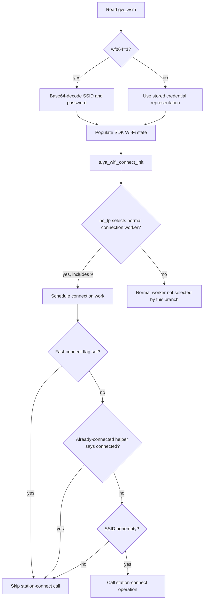
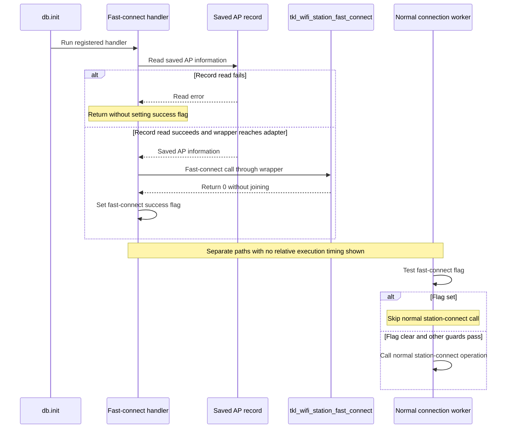
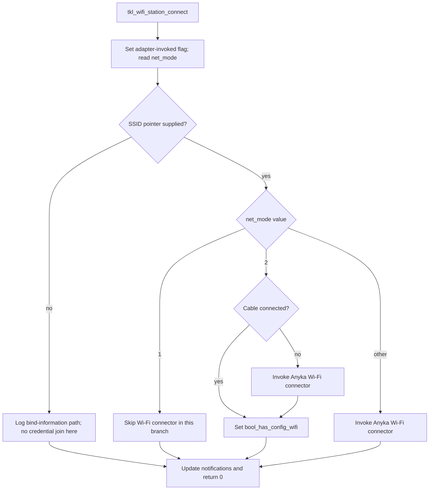
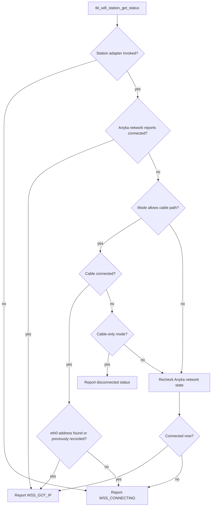

# Wi-Fi internals

These diagrams describe the [examined firmware](../index.md#examined-firmware). They separate credential decoding, worker selection, adapter calls and reported connection state. See [boot and Wi-Fi](../boot-wifi.md) for their place in startup.

## Credential loading and worker selection

*Decoding credentials and scheduling work are separate from actually calling the station adapter.*

Functions: `wd_gw_wsm_read()` and `tuya_wifi_connect_init()`, followed by the connection worker. [Scratch records](../../../src/tuyha/materializer/records.py) use `wfb64=1`, `nc_tp=9` and `stat=2`. This graph does not impose an order on the separate `db.init` handler.

Delayed-work initialization and work-mode setup can fail before the join guards shown here.

## Fast-connect cache can suppress a real join

*In this executable, a successful return from the fast-connect adapter does not mean an access-point join occurred.*

Functions: `tuya_wifi_fastconnect_init()`, the `db.init` handler, `tal_fast_station_connect()` and `tkl_wifi_station_fast_connect()`. Scratch creation omits `ap_info_v3`; [scratch verification](../../../src/tuyha/anyka/scratch_verify.py) rejects it. A full-dump import can retain it.

## Station-adapter network mode

*The adapter can return 0 without calling the Wi-Fi connector, depending on its inputs and network mode.*

Function: `tkl_wifi_station_connect()` at `0x000da914`. Its connector helper reaches `ht_network_connect_wifi()`. The adapter-invoked flag is not a successful-association flag; notifications and a zero return do not establish an IP address.

## Connection-status reporting

*Status can reflect the cable path or an uninvoked adapter; it is not necessarily a WLAN association result.*

Function: `tkl_wifi_station_get_status()`. A null output pointer returns an argument error before these branches. Check the actual interface, address and route when validating a camera. Logs can contain SSIDs, passwords and addresses; redact before sharing.
