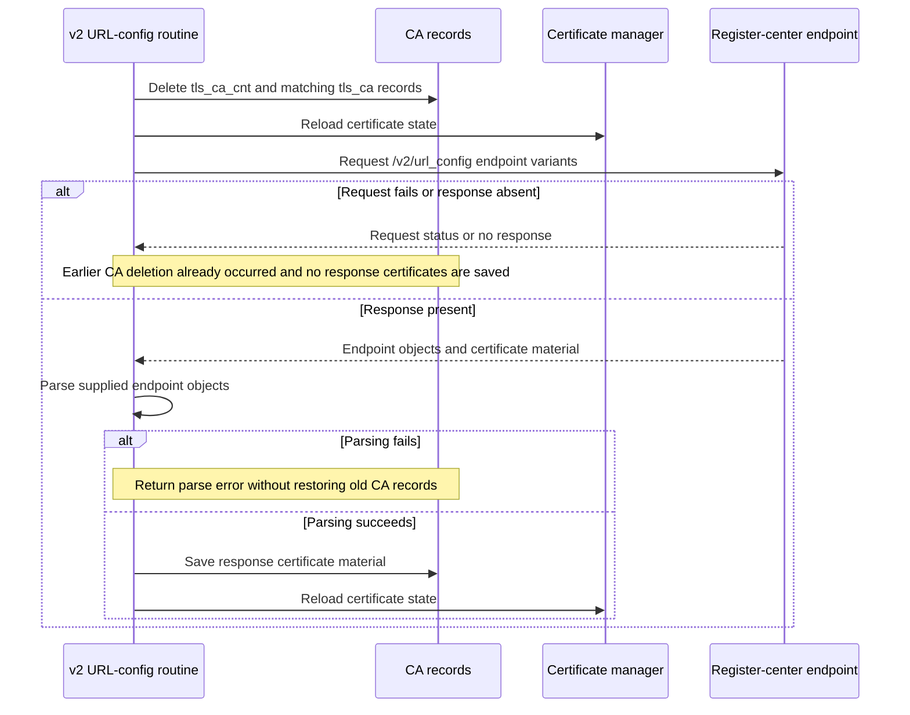
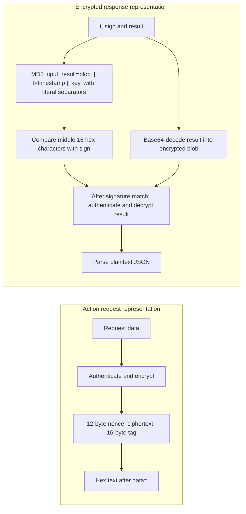

# Firmware HTTP protocol

These findings describe the [examined firmware](index.md#examined-firmware). They are not a supported HTTP service or proof of app control on the local RTSP setup.

See [HTTP diagrams](diagrams/http.md) for URL-config and action-exchange branches.

## URL configuration

**Firmware analysis:** One discovery path constructs `/v2/url_config` from the register-center URL, requests HTTP, MQTT, standard TLS, PSK and ghost endpoint variants, then parses returned endpoint objects. Its parser reads an address and the first available array entry; the response branch can fail when a supplied endpoint cannot be parsed. A separate path constructs `/v1/url_config`.

Before the v2 request, this function deletes `tls_ca_cnt`, deletes matching `tls_ca` records, and reloads certificate state. After successful parsing, it saves certificates from the response and reloads certificate state. A failed request can therefore leave trust records changed. See [MQTT, TLS and RCS](mqtt-tls-rcs.md#trust-records) for the certificate records.

*The v2 request mutates stored trust before network success; this path has no shown rollback to the deleted CA set.*

## Encrypted action exchange

**Firmware analysis:** One action-request builder creates `data=` followed by hex-encoded authenticated ciphertext. Its blob has a 12-byte nonce and 16-byte tag. In the encrypted response branch, `__httpc_gw_common_cb()` reads `t`, `sign` and `result`. It hashes `result=<blob>||t=<timestamp>||<key>` with MD5, compares the middle 16 hexadecimal characters, base64-decodes `result` and authenticates/decrypts it before parsing JSON. An `e:false` response takes a different branch.

This records firmware behavior, not a recommendation to use MD5 in a new protocol. TuyHA does not provide an HTTP emulator or use this exchange for the local boot latch.

*Request ciphertext uses hex text; the encrypted response's `result` uses base64 and a separate signature check.*

The exact signed string is `result=<blob>||t=<timestamp>||<key>`. The graph shows data dependencies, not permission to decode before checking the signature. See [response decision branches](diagrams/http.md#encrypted-action-exchange).

## Safety

Requests, responses, decoded JSON and debug logs can expose credentials, identifiers or other private data. Do not publish raw captures, encrypted blobs or signing inputs. Neither a valid signature nor this protocol description establishes successful control or media streaming.
