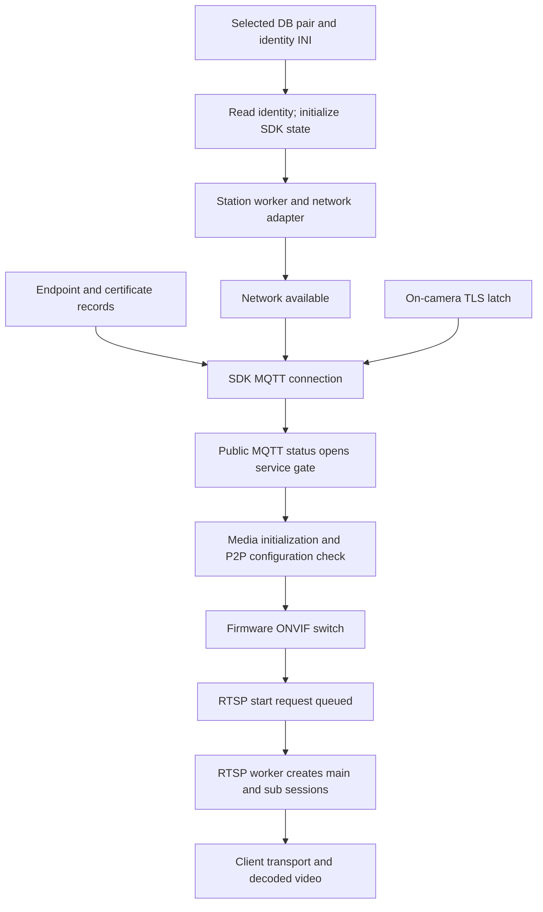

# Anyka firmware research

These notes capture the examined Anyka/Tuya firmware path, not a specification for every camera. They support readers investigating another firmware or extending the project. For deployment, start with the [SD payload guide](../SD_CARD.md) and [hardware validation runbook](../hardware-validation.md).

## How the parts fit



*The local RTSP path crosses identity, network, MQTT, media and asynchronous RTSP gates; passing one does not prove the next.*

This is a dependency view, not a thread schedule. The CLI produces files; it does not call camera functions. Follow the topic pages for the checked branches and the [evidence scope](#evidence-and-scope) for their limits.

## Topics

| Topic | Contents |
|---|---|
| [Boot and Wi-Fi](boot-wifi.md) | Identity checks, station join, fast-connect cache, MQTT boot gate. |
| [Database and identity](database.md) | KV file format, generated records, identity INI, limits. |
| [Decompilation methods and interventions](decompilation.md) | Image provenance, symbol checks, Ghidra evidence and branches steered by the payload. |
| [MQTT, TLS and RCS](mqtt-tls-rcs.md) | Local latch, MQTT status and payload, trust records, register-center fallback. |
| [Firmware HTTP protocol](http-protocol.md) | URL-config parsing and encrypted action responses on the examined firmware path. |
| [Media and RTSP](media-rtsp.md) | P2P configuration gate, ONVIF switch, RTSP endpoints and playback behavior. |

## Workflow diagrams

| Diagram | Coverage |
|---|---|
| [Boot, Wi-Fi and media](diagrams/boot-media.md) | Identity, station worker, MQTT gate, P2P configuration and RTSP. |
| [Wi-Fi internals](diagrams/wifi.md) | Credential loading, cache suppression, adapter network modes and connection-status reporting. |
| [Database and logging state](diagrams/database.md) | Tracked DB build/load and firmware log-level expiry. |
| [MQTT and RCS](diagrams/mqtt-rcs.md) | Distinct status variables, payload parsing, latch packet handling and register-center state. |
| [Firmware HTTP paths](diagrams/http.md) | URL configuration, endpoint parsing and encrypted action-response branches. |
| [RTSP runtime](diagrams/media-runtime.md) | Queued start/stop, listener/session creation, frame delivery and PLAY state. |
| [Product and developer workflows](../index.md#workflow-diagrams) | Creation, DB inspection, SD boot and validation. |

## Evidence and scope

- **Implementation** means behavior visible in tracked TuyHA code, SD scripts, or latch source. It is not proof that a camera used those files.
- **Firmware analysis** means behavior checked in one `anyka_ipc` binary through symbols, disassembly and decompilation. It does not establish behavior on another build.
- **Reported hardware** means the project reports one LSC camera booted with scratch identity, an on-camera latch, and local RTSP. The published result does not include a raw successful-run capture. [Project status](../../AGENTS.md) and the [runbook](../hardware-validation.md) describe its scope.

### Examined firmware

The analyzed `anyka_ipc` executable has SHA-256:

```text
1b6e8150e4710c1d0b324e4ccb5ba1d93c4ea804742d26b38328aa94d34a88f7
```

It matches the `/usr/bin/anyka_ipc` extracted from the examined camera filesystem. This establishes byte identity between those two inputs, not a link to the reported successful scratch run. The pages here contain the findings directly; they do not require private dumps or analysis exports. See [decompilation methods](decompilation.md) for executable properties, function addresses and the analysis procedure.

## Compatibility limits

No other firmware compatibility is established. App control, cloud HTTP services and real P2P are not supported product workflows. Validate another deployment with its firmware revision, selected artifacts, active mounts, boot logs and decoded RTSP; a DB round-trip cannot prove camera acceptance.

## Evidence handling

Camera logs, DBs, profiles, captures, and manifests can contain credentials, device IDs, keys, or identifiers in record names. Never publish raw dumps or secret values. Review and redact evidence before sharing. Treat a generated DB pair as sensitive even though its values are encrypted.
