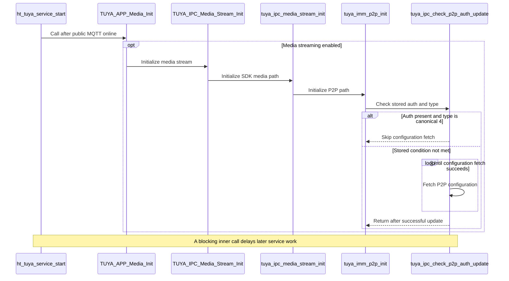
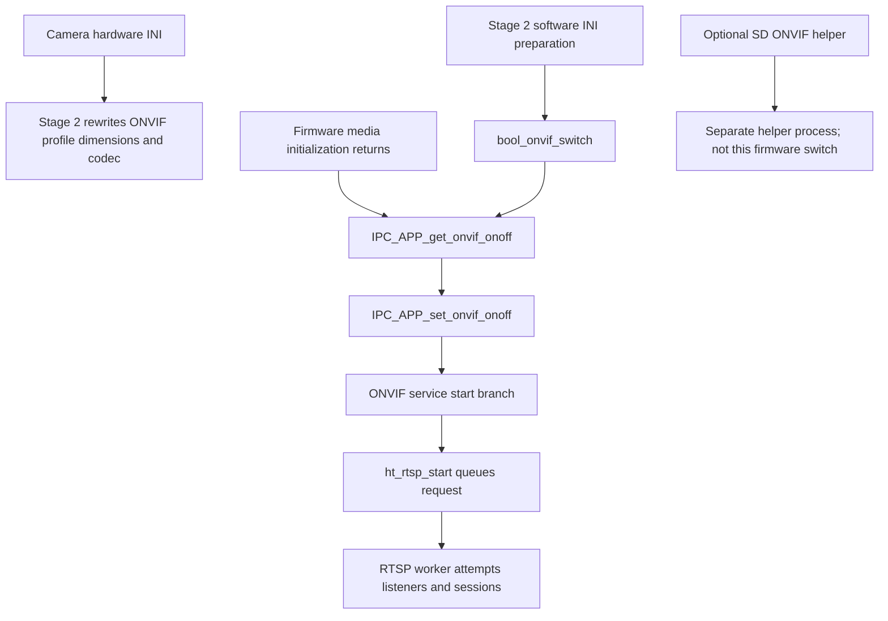

# Media and RTSP

These findings describe the examined firmware and the separately reported LSC result. See the [research index](index.md#evidence-and-scope) for evidence limits.

See [media-gate diagrams](diagrams/boot-media.md#p2p-configuration-and-rtsp) for configuration/password branches and [RTSP runtime diagrams](diagrams/media-runtime.md) for queued startup, sessions, PLAY state and frame delivery.

## P2P configuration gate

**Firmware analysis:** After MQTT status becomes online, `ht_tuya_service_start()` calls `TUYA_APP_Media_Init()`. When media streaming is enabled, the call chain is `TUYA_IPC_Media_Stream_Init()`, `tuya_ipc_media_stream_init()`, `tuya_imm_p2p_init()`, then `tuya_ipc_check_p2p_auth_update()`. That function reads `p2p_auth_info` and `p2p_type`. If both are nonempty and the type is exactly the canonical decimal string `4`, it skips the service update. Otherwise it calls the P2P configuration fetch and retries on failure.

*The call chain explains how an HTTP retry inside media initialization can delay later RTSP startup despite MQTT being online.*

**Implementation:** [records.py](../../src/tuyha/materializer/records.py) writes `p2p_type` as ASCII `4` plus NUL and `p2p_auth_info` as `{"p2pId":"","type":4}` plus NUL. It also writes a NUL-terminated placeholder `p2p_pwd`. **Firmware analysis:** The separate `tuya_ipc_p2p_get_pw()` function uses a nonempty stored password; if it is absent or empty, the function can call `httpc_ipc_p2p_passwd_update()` and retry. Neither branch proves real P2P capability.

MQTT online is not the final gate: a retry inside media initialization can delay the later ONVIF/RTSP call. Recheck the branches on each new firmware.

## ONVIF and endpoints

**Firmware analysis:** After media initialization returns, the service reads and sets the ONVIF switch. The setter can start the ONVIF service, whose start calls `ht_rtsp_start()`. That call queues a start message. The RTSP worker later creates listeners on decimal ports `88` and `89`, with `/videoMain` and `/videoSub` sessions. Queueing a request does not establish that listener or session creation succeeded.

**Implementation:** [stage 2](../../sd_card/custom/scripts/hack_stage_2.sh) sets `bool_onvif_switch` and rewrites ONVIF profile dimensions and codec from the camera's `_ht_hw_settings.ini`. This switch is distinct from the optional SD ONVIF helper; see [SD payload guide](../SD_CARD.md).

*Hardware profile rewriting, the firmware ONVIF switch and the optional helper are different mechanisms.*

The setter dispatches start/stop only when its configuration helper returns nonzero. See [queued lifecycle](diagrams/media-runtime.md#queued-start-and-stop) for the remaining asynchronous boundary.

**Reported hardware:** [Project status](../../AGENTS.md) reports UDP playback on one LSC camera, including after latch exit. This does not establish playback on other camera models or revisions. The reported firmware stalls on interleaved RTP-over-TCP; use UDP when following the [validation runbook](../hardware-validation.md).

## Playback observations and limits

**Firmware analysis:** The routine logging `rtsp_handle_PLAY` sets stream positions to `streamq_tail()`. The [boot-to-RTSP guide](../LOCAL_RTSP.md) reports that clients can join mid-GOP and wait for the next IDR. A port opening or RTSP DESCRIBE alone does not show decoded video. Record the codec, frame dimensions, transport, duration, and result of both streams when validating another unit.

The RTSP switch and P2P seed do not establish Tuya app control or working real P2P.
