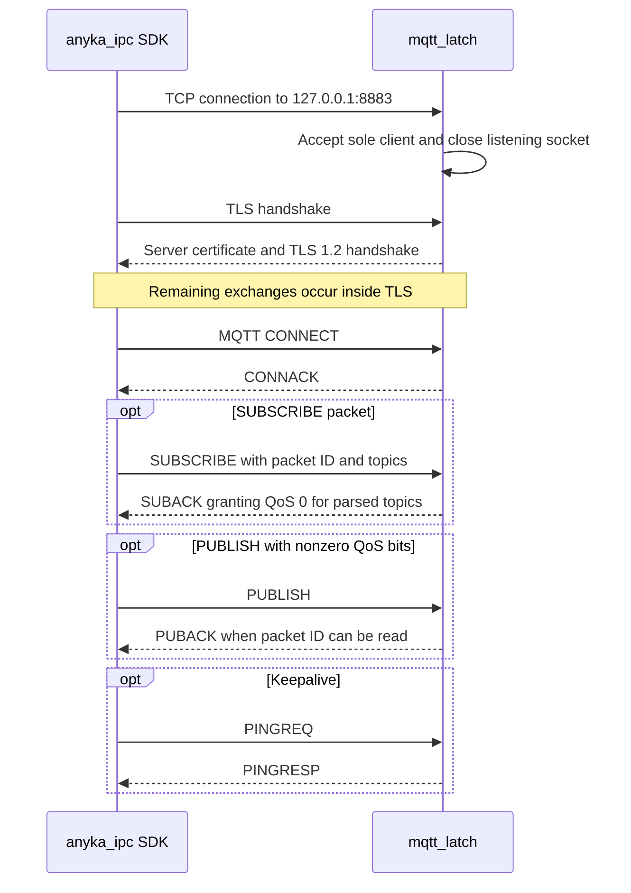
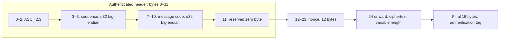
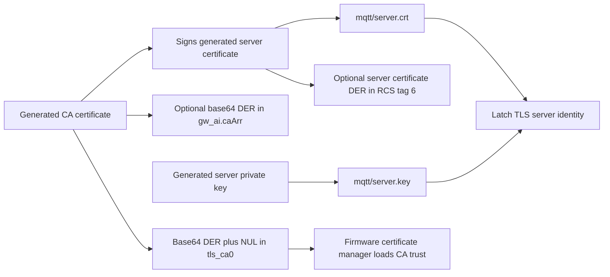

# MQTT, TLS and register center

Firmware findings apply to the [examined executable](index.md#examined-firmware). Implementation details refer to checked-in source.

See [MQTT and RCS diagrams](diagrams/mqtt-rcs.md) for status, payload, fallback and trust paths.

## MQTT boot latch

**Firmware analysis:** MQTT status controls the service gate described in [boot and Wi-Fi](boot-wifi.md). One MQTT CONNECT construction uses protocol name `MQIsdp` and level `3`, corresponding to MQTT 3.1. This is not proof that every connection or firmware revision uses that version.

**Implementation:** [mqtt_latch.c](../../latch/mqtt_latch.c) accepts one TLS client, responds to CONNECT, SUBSCRIBE, PUBLISH and PING packet types, and exits when its loopback probe finds port `88` listening. It does not implement a full broker or app-control service. Although the camera targets `127.0.0.1:8883`, the source binds `INADDR_ANY`, so the listener is not restricted to loopback. It can also exit before RTSP on connection failure or disconnect.

*The tracked latch answers a narrow packet exchange; it does not authenticate client credentials, route messages or decode Tuya payloads.*

The source only probes port `88` after TLS setup and between packet reads. An unrelated client can occupy the sole connection. See [packet and exit branches](diagrams/mqtt-rcs.md#latch-packet-dispatch).

The [startup script](../../sd_card/custom/scripts/anyka_ipc.sh) launches the latch if its binary and TLS files exist, then starts `anyka_ipc` with the preload when present. [nobind.c](../../latch/nobind.c) suppresses `SO_BINDTODEVICE`; it does not change every network option. The script and source do not prove that the preload or latch was active during a particular boot.

## MQTT events and status

**Firmware analysis:** `ty_publish_event()` validates an event name, obtains an event node and dispatches subscribers under its mutex. One initialization path subscribes handlers to `mqtt.con` and `mqtt.disc`. Those handlers set the event-handler status to 1 and 0 respectively through `tuya_ipc_set_mqtt_status()`.

The ELF exports `ty_publish_event` at `0x001e2824`, `ty_subscribe_event` at `0x001e291c`, and `ty_unsubscribe_event` at `0x001e2ac0`. See [verified function addresses](decompilation.md#verified-function-addresses).

The service boot gate reads a **different variable** through `TUYA_IPC_Get_MqttStatus()`. Online and offline status callbacks set that boot-gate variable. These are separate checked paths; publishing an event alone is not proof that the boot gate opens.

## MQTT 2.3 payload

**Firmware analysis:** One MQTT application-payload parser checks for version `2.3`, reads two big-endian 32-bit fields, and requires the reserved byte to be zero. Its layout is `"2.3" | sequence (4) | message code (4) | reserved (1) | nonce (12) | ciphertext | tag (16)`; the first 12 bytes are authenticated as additional data. The corresponding packer uses the same offsets. This envelope sits inside MQTT PUBLISH; it is distinct from the MQTT 3.1 CONNECT version above.

*MQTT carries this application envelope as PUBLISH data; its `2.3` marker does not describe the MQTT connection protocol version.*

The latch acknowledges MQTT packets without decoding this application envelope. The envelope layout does not establish command delivery or app control.

## Trust records

**Firmware analysis:** The certificate manager writes each URL-config `caArr` element to `tls_caN` with its terminating NUL and stores `tls_ca_cnt`. It later reads the count and base64-decodes each `tls_caN` into DER bytes. RCS tag 6 holds certificate bytes; the save path converts PEM to DER. These surfaces are related but should not be assumed interchangeable.

**Implementation:** [records.py](../../src/tuyha/materializer/records.py) writes `tls_ca0` as base64 DER plus NUL and optionally embeds the CA in `gw_ai.caArr` and server certificate DER in `rcs.active`. [generator.py](../../src/tuyha/tls/generator.py) sets CA and server `notBefore` to 1999-01-01 and adds both DNS and IP SANs for an IP broker. Its comments describe the examined camera's boot clock and mbedTLS name-matching behavior. Revalidate those choices on other firmware.

*CA trust, RCS certificate bytes and the latch's private server key have distinct roles; the private key does not belong in a CA record.*

This maps tracked generation, not every firmware trust decision. The CA private key is not written. DB decoding requires the enckey file, not `server.key`.

## Register-center fallback

**Firmware analysis:** When no RCS endpoint is already in memory, `tuya_register_center_init()` tries `rcs.active` and, if its read fails, `rcs.mf`. If neither read succeeds or the selected record fails parsing, it falls back to defaults; the regional-default routine can construct `h3-<region>.iot-dns.com` and `h6-<region>.iot-dns.com`. `tuya_register_center_reset()` deletes `rcs.active`, not `rcs.mf`. A static blocklist cannot be assumed complete from one endpoint alone.

**Implementation:** [rcs.py](../../src/tuyha/anyka/rcs.py) emits type, little-endian length and value entries: `1` source, `2` pub, `3` code, `4` and `5` URLs, `6` optional certificate DER. The codec preserves these fields; it does not establish their full semantics on other firmware.

## Further protocol research

See [firmware HTTP protocol](http-protocol.md) for the separate URL-config and encrypted-response paths. Do not publish captured packet bodies, topic IDs or device credentials. App control and real P2P are not supported by the local RTSP workflow.
